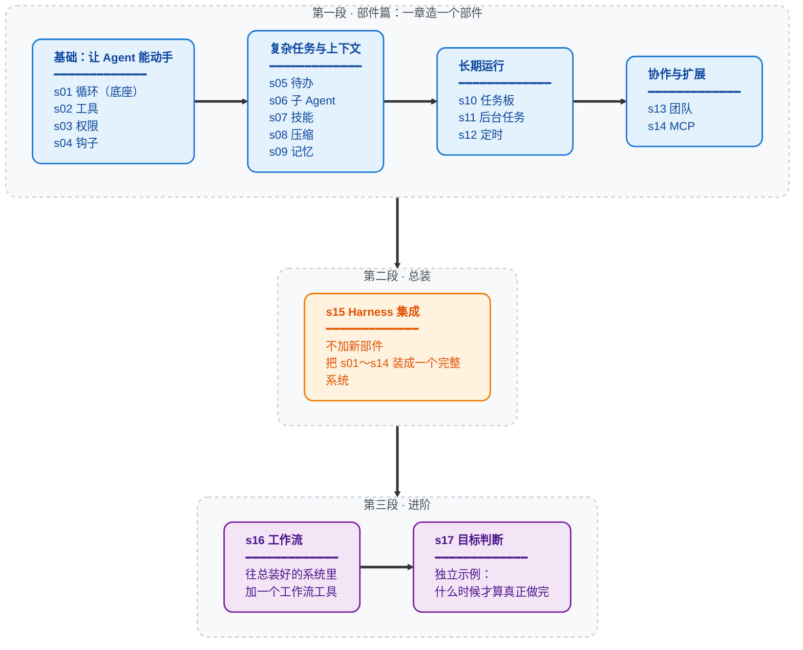

# Learn Claude Code：亲手造一遍 Agent Harness，学会做 AI 产品判断

写给 AI 零基础的同学和准 AI 产品经理。

> **用自研的方式学**：照着 Claude Code，从一个循环开始，把一个 Agent 的部件亲手造一遍。
> **学会的是判断**：拿到一个产品需求，能说清楚该不该用 Agent、走哪条路、用哪些部件、规则怎么定。

不会编程也能学。每章的代码可以只看网页上的「回放」动画，每章末尾的「产品经理视角」才是重点。第一次来，先读 [第 0 课 · 导读](guide/intro.md)。

---

## 学完要达到的标准

给你一个产品需求或方案，你能准确判断：

1. **要不要用 Agent**。有些需求根本不需要。
2. **五条路走哪条**：直接用成品、用厂商开发包、用通用框架、用低代码平台，还是完全自研，并说清理由。
3. **部件怎么定**：如果自研，16 个部件里用哪些、暂不用哪些；如果不自研，这条路自带哪些部件、缺哪些、缺的致不致命。

最后把判断填进一张「判断结论卡」，写清规则和指标。判断流程和结论卡见 [选型篇](guide/README.md)，结课用 [练习](guide/practice.md) 里的综合验收题检验。

**不要求会写代码。** 每章都附有能运行的基础代码，需要改的时候，交给 AI 在这份代码上改就行。

---

## 先分清三层：模型、Harness、产品

| 层 | 是什么 | 比喻 | 以 Claude Code 为例 |
|---|---|---|---|
| **模型** | 负责思考和做决定 | 司机 | Claude |
| **Harness** | 让模型能动手干活的一整套机制 | 车 | 反复调用模型的循环、读写文件和执行命令的工具、危险操作前的确认、长对话压缩、记忆…… |
| **产品** | 用户看到和用到的东西 | 车的外观、售价、售后 | 终端界面、各种命令、订阅收费 |

模型由几家大厂训练，大多数公司只能挑选。产品界面谁都会关注。夹在中间的 Harness，决定了 Agent 能做什么、不能做什么、出错了怎么兜底。**这门课只讲这一层。**

为什么拆的是 Claude Code？因为它是目前最完整的 Agent Harness 之一，而且思路很克制：不替模型做决定，只给模型工具、知识、上下文管理和权限边界，然后让模型自己干活。拿它当标本，最容易看清每个部件的作用。

---

## 自研着学，不等于产品要自研

做一个 Agent 产品有五条路：

| 路线 | 比喻 | 代表 |
|---|---|---|
| 直接用成品 | 买一辆整车 | Claude Code、Codex |
| 用厂商开发包 | 买厂商的底盘，自己装车身 | Claude Agent SDK、OpenAI Agents SDK |
| 用通用框架 | 买标准零件自己组装 | LangChain、LangGraph |
| 用低代码平台 | 用乐高拼 | Dify、Coze |
| **完全自研** | 自己造车 | **这门课的做法** |

这门课走最后一条路，是因为只有自己造一遍，才知道每个部件解决什么问题、要付出什么代价、哪些规则该由产品经理来定。真做产品时走哪条路，要看五个问题：需不需要 Agent、内部用还是给客户用、有没有工程师、模型和数据有没有限制、Harness 是不是核心竞争力。这些在 [选型篇](guide/README.md) 里展开讲。

---

## 课程怎么安排

| 部分 | 内容 | 重点 |
|---|---|---|
| **开始之前** | [第 0 课 · 导读](guide/intro.md)、[名词表](guide/glossary.md) | 这门课要你学会什么，每章该怎么读；看不懂的词随时查 |
| **第一段 · 部件篇** | s01～s14 | 一章造一个部件，s01 循环是所有部件的底座 |
| **第二段 · 总装** | s15 | 不加新部件，把 s01～s14 装成一个完整的系统，看它们怎样互相影响 |
| **第三段 · 进阶** | s16～s17 | s16 往总装好的系统里加工作流；s17 讲「什么时候才算真正做完」 |
| **决策实战** | [选型篇](guide/README.md)、4 个案例、[练习](guide/practice.md) 和 [参考答案](guide/practice-answers.md) | 按五步判断流程练习，最后用综合验收题检验 |

每章开头的「本章要学会的判断」告诉你这一章要带走什么，章末的「产品经理视角」是详细的判断方法。

为什么总装不放在最后？因为 s16 工作流是往 s15 总装好的系统里再加一个工具，必须先有 s15。数部件时，s01 循环也算一个，所以是 16 个部件 + 1 章总装。

### 每章一句话

> **s01** &nbsp; *"One loop & Bash is all you need"* &mdash; 一个工具 + 一个循环 = 一个 Agent
>
> **s02** &nbsp; *"加一个工具, 只加一个 handler"* &mdash; 循环不用动, 新工具注册进 dispatch map 就行
>
> **s03** &nbsp; *"先划边界, 再给自由"* &mdash; 先判断操作能不能做，要不要问用户
>
> **s04** &nbsp; *"挂在循环上, 不写进循环里"* &mdash; 在工具前后留插口，不改主循环也能扩展
>
> **s05** &nbsp; *"没有计划的 agent 走哪算哪"* &mdash; 先列步骤再动手, 完成率翻倍
>
> **s06** &nbsp; 给子任务全新的 `messages[]`，最终文本作为一条工具结果返回
>
> **s07** &nbsp; *"用到时再加载, 别全塞 prompt 里"* &mdash; 技能先列目录，用到时再展开
>
> **s08** &nbsp; *"上下文总会满, 要有办法腾地方"* &mdash; 四步压缩，先整理工具结果，仍然超限时再生成历史摘要
>
> **s09** &nbsp; *"记住该记的, 忘掉该忘的"* &mdash; 三个子系统: 筛选、提取、整理
>
> **s10** &nbsp; *"大目标拆成小任务, 排好序, 持久化"* &mdash; 文件持久化的任务图, 多 agent 协作的基础
>
> **s11** &nbsp; *"慢操作丢后台, agent 继续思考"* &mdash; 后台线程跑命令, 完成后注入通知
>
> **s12** &nbsp; *"定时触发, 不需要人推"* &mdash; 按时间自动触发任务
>
> **s13** &nbsp; *"一个 Agent 顾不过来，就让队友分工协作"* &mdash; 持久队友协作、认领就绪任务，并使用任务绑定的工作目录
>
> **s14** &nbsp; *"能力不够? 插上 MCP"* &mdash; 把外部工具接进同一个工具池
>
> **s15（总装，不是部件）** &nbsp; *"多种机制，一个循环"* &mdash; 不加新部件，把前面的部件装进同一个循环
>
> **s16** &nbsp; *"编排形状固定时，就把它写进代码"* &mdash; 保存好的 workflow 使用 journal 续跑
>
> **s17** &nbsp; *"目标决定循环什么时候真正结束"* &mdash; 每次准备停止时都由独立判断器审查；目标不可能、执行失败或超过续跑上限时把控制权交还用户

---

## 零基础学生使用流程（推荐 Mac）

> **只想看课**：直接打开课程网页 <https://hubooooooo.github.io/claude-code-harness-study/>，每节课的讲解、图示、新增代码对比和运行回放都在里面，不用安装任何东西。想亲手运行代码，再按下面的步骤操作。

1. 打开项目 GitHub 页面，点右上角绿色 `Code` → `Download ZIP`，下载后解压。
2. 进入解压后的文件夹，双击 `启动.command`。
   - 如果提示“无法打开/来自身份不明的开发者”：按住 `Control` 点按 `启动.command`，选“打开”，再点“打开”。
3. 保持联网等待。脚本会自动检查 Python；如果没有，会引导自动安装。弹出管理员密码框时，输入 Mac 开机密码。
4. 第一次运行会自动安装依赖。看到 `请输入你的 DeepSeek API Key` 时：
   - 打开 https://platform.deepseek.com/ 注册并登录；
   - 在控制台创建 API Key 并复制；
   - 回到终端窗口粘贴，然后按回车。
5. 看到 `run >>` 菜单后，输入章节编号开始上课：
   - `s01` 回车：第一课；
   - 之后依次输入 `s02`、`s03` … `s17`；
   - 课程里输入 `q`：退出当前章节，回到菜单；
   - 菜单里输入 `q`：退出整个程序。
6. 第二次以后，仍然双击 `启动.command`，即可直接进入课程。
7. 想用网页上课：在 `run >>` 菜单里输入 `web` 回车，浏览器会打开课程网页。先点「第 0 课 · 导读」，再从 s01 开始。每节课有四个标签：
   - 「讲解」：README 和图示；
   - 「代码」：本课相对它所基于的章节新增的代码，用绿色高亮；
   - 「回放」：一次真实运行的录像，一步步看每次发给模型的 `messages[]` 和模型的返回，不需要 key；
   - 「运行」：在你的电脑上直接运行本课代码，边跑边看（需要 key，在一份临时副本里运行，不会改动项目文件）。

**Windows 用户**：目前自动安装脚本优先支持 Mac。Windows 请先到 https://www.python.org/downloads/ 安装 Python 3.11 或更高版本，安装时勾选 `Add Python to PATH`，然后在项目文件夹打开终端运行：

```powershell
python run.py
```

## 命令行方式（可选）

如果你习惯用终端，也可以这样做：

```sh
git clone https://github.com/huuuboo/learn-claude-code
cd learn-claude-code

# 自动装依赖 + 首次引导填 key + 菜单选择章节 s01–s17
python3 run.py

# 高级用法：
python run.py 3               # 直接运行指定章节（3 / s03 / agent_loop 均可）
python run.py s16 demo        # s16 附带的 demo / resume 模式
python run.py web             # 打开课程网页（讲解 / 代码对比 / 运行回放 / 网页里直接运行）
python s01_agent_loop/code.py # 各章代码仍可独立运行
```

## 学习路径

先读 [第 0 课 · 导读](guide/intro.md)，再按下图学 17 章，最后进入 [选型篇](guide/README.md)。分组和课程网页的侧栏一一对应。



## 全部章节（技术关键词）

| 章节 | 主题 | 关键概念 |
|---|---|---|
| [s01](./s01_agent_loop/) | Agent Loop | `messages` / `while True` / `tool_use` |
| [s02](./s02_tool_use/) | Tool Use | `TOOL_HANDLERS` / dispatch map / 并发 |
| [s03](./s03_permission/) | Permission | `PermissionRule` / 审批管线 |
| [s04](./s04_hooks/) | Hooks | `PreToolUse` / `PostToolUse` / 扩展点 |
| [s05](./s05_todo_write/) | TodoWrite | `TodoItem` / 先计划后执行 |
| [s06](./s06_subagent/) | Subagent | `fresh messages[]` / 上下文隔离 |
| [s07](./s07_skill_loading/) | Skill Loading | `SkillLoader` / 技能目录 / 按需注入 |
| [s08](./s08_context_compact/) | Context Compact | budget / snip / micro / summary 四步压缩 |
| [s09](./s09_memory/) | Memory | selection / extraction / consolidation |
| [s10](./s10_task_system/) | Task System | `TaskRecord` / `blockedBy` / 磁盘持久化 |
| [s11](./s11_background_tasks/) | Background Tasks | 线程执行 / 通知队列 |
| [s12](./s12_cron_scheduler/) | Cron Scheduler | 持久化调度 / 会话级触发 |
| [s13](./s13_agent_teams/) | Agent Teams | 持久队友 / 原子认领 / 任务绑定的 Worktree / 类型协议 |
| [s14](./s14_mcp_plugin/) | MCP Plugin | 工具发现 / 命名空间 / 工具池组装 |
| [s15](./s15_integrated_harness/) | Agent Harness 集成（总装） | 工具、运行时上下文、任务、团队、调度和 MCP 归到一个循环 |
| [s16](./s16_workflow_runtime/) | Workflow Runtime | 脚本编排 / 生命周期事件 / journal 续跑 |
| [s17](./s17_goal_loop/) | Goal Loop | 目标闸门 / 对话判断 / 自动续轮 |

## 给想看代码的同学

整个 Agent 的核心就是下面这个循环：调用模型，模型要用工具就执行、把结果交回去，模型不再用工具就结束。后面每一章都是围绕它加一个部件。

```python
def agent_loop(messages):
    while True:
        response = client.messages.create(
            model=MODEL, system=SYSTEM,
            messages=messages, tools=TOOLS,
        )
        messages.append({"role": "assistant",
                         "content": response.content})

        tool_calls = [
            block for block in response.content if block.type == "tool_use"
        ]
        if not tool_calls:
            return

        results = []
        for block in tool_calls:
            output = TOOL_HANDLERS[block.name](**block.input)
            results.append({
                "type": "tool_result",
                "tool_use_id": block.id,
                "content": output,
            })
        messages.append({"role": "user", "content": results})
```

## 项目结构

```
learn-claude-code/
  s01_agent_loop/          # 每章一个文件夹
    README.md              #   中文文档（完整叙事）
    code.py                #   独立可运行代码
    images/                #   SVG 流程图
  s02_tool_use/
  ...
  s14_mcp_plugin/
  s15_integrated_harness/
  s16_workflow_runtime/
  s17_goal_loop/           # 终点章
  guide/                   # 导读（intro.md）、名词表（glossary.md）、选型篇（README.md）、4 个案例、练习（practice.md）和参考答案（practice-answers.md）
  web/                     # 课程网页（直接读取各章 README / 图 / code.py）
    viz.js                 #   回放：每章一段机制动画
    live_hook/             #   「运行」页的事件记录钩子；live_prompts.json 是各章的推荐提问
  skills/                  # s07 使用的 skill 文件
  tests/
```

## 许可证

MIT
