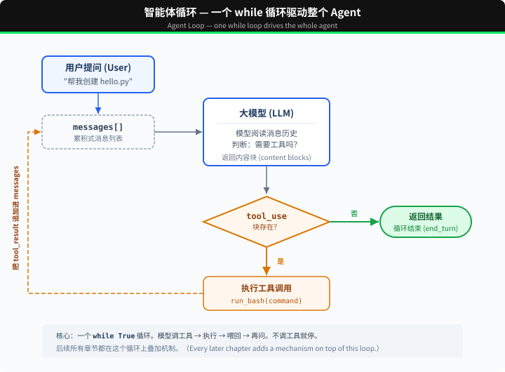

# s01: Agent Loop — 一个循环就够了

`s01` → [s02](../s02_tool_use/) → s03 → s04 → ... → s16 → s17
> *"One loop & Bash is all you need"* — 一个工具 + 一个循环 = 一个 Agent。
>
> **Harness 层**: 循环 — 模型与真实世界的第一道连接。

---

## 问题

你提出了一个问题给大模型：“帮我读取下我的目录下有哪些文件，并且执行XXX.py”。

模型能输出一条 bash 命令，但输出完了就停了，它不会自己跑，也不会看到结果后继续推理。

你可以手动跑一遍，把输出粘贴回对话框，让它接着干。下一个命令出来，你再跑一遍、再贴回去。

每一个来回，你都在做中间层。而把它自动化，就是这一章要做的事。

---

## 解决方案



一个 `while True` 循环，模型调用工具就继续，不调用就停。循环直接检查响应里的内容块：

| 信号 | 含义 | 循环动作 |
|------|------|---------|
| 包含 `tool_use` block | 模型要求调用工具 | 执行 → 结果喂回去 → 继续 |
| 不包含 `tool_use` block | 模型没有调用工具 | 退出循环 |

---

## 工作原理

将这个过程翻译成代码。分步来看：

**第 1 步**：把用户的问题作为第一条消息。

```python
messages = [{"role": "user", "content": query}]
```

**第 2 步**：将消息和工具定义一起发给 LLM。

```python
response = client.messages.create(
    model=MODEL, system=SYSTEM, messages=messages,
    tools=TOOLS, max_tokens=8000,
)
```

**第 3 步**：追加模型回答，检查它是否调了工具。没调 → 结束。

```python
messages.append({"role": "assistant", "content": response.content})
tool_calls = [
    block for block in response.content if block.type == "tool_use"
]
if not tool_calls:
    return
```

只有实际存在的 `tool_use` block 才会进入执行阶段，因此不会追加空的工具结果消息。

**第 4 步**：执行模型要求的工具，收集结果。

```python
results = []
for block in tool_calls:
    output = run_bash(block.input["command"])
    results.append({
        "type": "tool_result",
        "tool_use_id": block.id,
        "content": output,
    })
```

**第 5 步**：把工具结果作为新消息追加，回到第 2 步。

```python
messages.append({"role": "user", "content": results})
```

组装为一个完整函数：

```python
def agent_loop(messages):
    while True:
        response = client.messages.create(
            model=MODEL, system=SYSTEM, messages=messages,
            tools=TOOLS, max_tokens=8000,
        )
        messages.append({"role": "assistant", "content": response.content})

        tool_calls = [
            block for block in response.content if block.type == "tool_use"
        ]
        if not tool_calls:
            return

        results = []
        for block in tool_calls:
            output = run_bash(block.input["command"])
            results.append({
                "type": "tool_result",
                "tool_use_id": block.id,
                "content": output,
            })
        messages.append({"role": "user", "content": results})
```

三十多行，这就是最小可运行的 agent harness 内核。它为模型提供持续行动的最小运行框架：模型负责决策（要不要调工具、调哪个），harness 负责执行（调用工具，把结果作为新消息追加）。后面 16 个章节都在这个循环上叠加机制，循环本身始终不变。

---

## 试一下

> **安全提示**：代码会执行模型生成的 shell 命令。建议在一个临时测试目录中运行，避免影响你的项目文件。s03 会加入权限控制。

**准备**（首次运行）：

```sh
pip install -r requirements.txt
cp .env.example .env
# 编辑 .env，填入 ANTHROPIC_API_KEY 和 MODEL_ID
```

**运行**：

```sh
python s01_agent_loop/code.py
```

试试这些 prompt：

1. `Create a file called hello.py that prints "Hello, World!"`
2. `List all Python files in this directory`
3. `What is the current git branch?`

观察重点：模型什么时候调用工具（循环继续），什么时候不调用（循环结束）？

---

## 产品经理视角

> 循环让 Agent 能自己接着干，也让它可能停不下来。产品经理不用管循环怎么写，要管的是它的「刹车」。

### 什么信号说明需要它

- 用户要反复把结果贴回给 AI，才能推进下一步。这正是本章开头的场景。
- 下一步做什么，取决于上一步的结果：先查再判断，试了不行再换个办法。
- 反过来，如果每个请求都是一问一答就结束，就不需要循环。

### 代价

- **步数不可预测**：同一个问题，这次走 3 步，下次可能走 15 步，费用和等待时间都跟着变。
- **可能原地打转**：反复尝试同一个办法，迟迟不结束。
- **出错机会变多**：每多一步，就多一次出错的可能。

### 先试试更便宜的办法

- 只调用一次模型就能完成的事（摘要、翻译、改写），不需要循环。
- 步骤完全固定的事，用固定流程（见 s16）。

### 你要拍板的规则

| 规则 | 示例 |
|---|---|
| 最多走几步 | 一次请求最多 20 步 |
| 费用和时间上限 | 单个任务不超过 2 元、5 分钟 |
| 超限后怎么办 | 停下来，告诉用户做到了哪一步，问要不要继续 |
| 什么时候算结束 | 默认是模型不再调用工具；需要更严格的完成标准，见 s17 |

### 怎么衡量

- 平均步数，以及步数最多的那 5% 任务各走了多少步。
- 触发上限的比例：太高，说明上限定得太紧，或者任务本身太难。
- 单个任务的平均费用和平均耗时。

### 真实产品里的样子

- Claude Code、Cursor 的 Agent 模式、Devin 这类产品，核心都是这个循环。
- 主流开发包都自带「最多几轮」的设置：OpenAI Agents SDK 默认最多跑 10 轮，超过就报错停下；Claude Agent SDK 也可以设最大轮数。刹车框架已经给了，**数字要由产品经理来定**。

### 面试题

**「用户抱怨 Agent 有时很快、有时要等好几分钟，费用也忽高忽低，你怎么处理？」**

答题要点：

- 根源是循环的步数不确定，不是网络慢。
- 先看数据：步数分布如何，哪类任务步数特别多。
- 设上限，并定好超限后怎么办。
- 让用户看到进度（每一步在做什么），等待的焦虑会小很多。
- 简单问题走「调用一次模型」的快速通道，不进循环。

> 17 个部件的判断卡放在一起比较，见 [选型篇](../guide/README.md)。

---

## 接下来

现在模型手里只有 bash 一个工具，读文件要 `cat`，写文件要 `echo ... >`，找个文件要 `find`，又丑又容易出错。

s02 Tool Use → 给它 5 个真正的工具，会发生什么？模型会不会一次调用多个工具？几个工具同时跑会不会互相踩？


<!-- translation-sync: zh@v1, en@v0, ja@v0 -->
