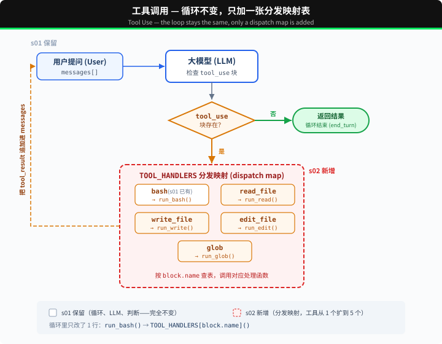

# s02: Tool Use — 多加一个工具，只加一行

s01 → `s02` → [s03](../s03_permission/) → s04 → ... → s16 → s17
> *"加一个工具, 只加一个 handler"* — 循环不用动, 新工具注册进 dispatch map 就行。
>
> **Harness 层**: 工具分发 — 扩展模型能触达的边界。

---

## 本章要学会的判断

- **它解决什么**：给模型一双手：查数据、读写文件、执行操作。
- **什么时候需要它**：光靠模型自己的知识不够，要去查、去改、去动手。
- **你要拍板的规则**：给哪些工具（越少越好）；哪些只读、哪些能写；工具说明由谁写、谁审。

> 代码看不懂可以先跳过，到网页上看「回放」动画。详细的判断方法在本章末尾的「产品经理视角」。

---

## 只有 bash 一个工具

s01 的 Agent 只有一个 bash 工具。读文件要 `cat`，写文件要 `echo "..." > file.py`，改文件要 `sed`。

模型想的是"读这个文件"，却要拼出 `cat path/to/file`。多了一层翻译，浪费 token，还容易拼错。

---

## 全局视角：工具分发



s01 的循环完全保留（LLM 调用、`tool_use` block 判断、消息追加）。唯一的变动在工具执行那 1 行：`run_bash()` 替换为 `TOOL_HANDLERS[block.name]()` 查表分发。

给 Agent 加一个工具只需要做两件事：

1. **定义工具**：在 `TOOLS` 数组里加一条描述
2. **注册处理函数**：在 `TOOL_HANDLERS` 字典里加一个映射

---

## 从 1 个工具到 5 个工具

s01 只有一个 bash：

```python
TOOLS = [{"name": "bash", ...}]

def run_bash(command): ...
```

s02 加到 5 个，每个工具都是独立定义：

```python
TOOLS = [
    {"name": "bash",       "description": "Run a shell command.", ...},
    {"name": "read_file",  "description": "Read file contents.",  ...},
    {"name": "write_file", "description": "Write content to file.", ...},
    {"name": "edit_file",  "description": "Replace text in file once.", ...},
    {"name": "glob",       "description": "Find files by pattern.", ...},
]
```

每个工具有自己的实现函数：

```python
def run_read(path, limit=None):
    lines = safe_path(path).read_text().splitlines()
    if limit:
        lines = lines[:limit]
    return "\n".join(lines)

def run_write(path, content):
    safe_path(path).write_text(content)
    return f"已写入（{len(content)} 字节）：{path}"

def run_edit(path, old_text, new_text):
    text = safe_path(path).read_text()
    if old_text not in text:
        return "错误：找不到要替换的文字"
    safe_path(path).write_text(text.replace(old_text, new_text, 1))
    return f"已修改 {path}"

def run_glob(pattern):
    import glob as g
    return "\n".join(g.glob(pattern, root_dir=WORKDIR))
```

---

## 工具分发

```python
TOOL_HANDLERS = {
    "bash":       run_bash,
    "read_file":  run_read,
    "write_file": run_write,
    "edit_file":  run_edit,
    "glob":       run_glob,
}

# 循环里只改了一行——从硬编码 run_bash 变成查表：
for block in tool_calls:
    handler = TOOL_HANDLERS[block.name]    # 查表
    output = handler(**block.input)         # 调用
    results.append(...)
```

加一个工具 = 在 `TOOLS` 数组加一条 + 在 `TOOL_HANDLERS` 字典加一行。循环不变。

---

## 多个工具调用

模型经常一次返回多个 tool_use："读一下 a.py 和 b.py，然后列出所有 .py 文件"。

这些调用按照 `response.content` 中的原始顺序逐个执行。

---

## 速查

| 概念 | 一句话 |
|------|--------|
| TOOL_HANDLERS | 工具名 → 处理函数的字典。加工具 = 加一行映射 |
| 工具定义 | 告诉模型"我能做什么"的 JSON schema |
| 多工具调用 | 模型可一次返回多个 tool_use，并按原始顺序逐个执行 |
| 循环不变 | s01 的 `while True` 循环一行都没改 |

---

## 相对 s01 的变更

| 组件 | 之前 (s01) | 之后 (s02) |
|------|-----------|-----------|
| 工具数量 | 1 (bash) | 5 (+read, write, edit, glob) |
| 工具执行 | 硬编码 `run_bash()` | TOOL_HANDLERS 查表分发 |
| 路径安全 | 无 | safe_path 校验（仅 file tools） |
| 循环 | `while True` + `tool_use` block | 与 s01 完全一致 |

---

## 试一下

```sh
cd learn-claude-code
python s02_tool_use/code.py
```

试试这些 prompt：

1. `Read the file README.md and tell me what this project is about`
2. `Create a file called test.py that prints "hello", then read it back`
3. `Find all Python files in this directory`
4. `Read both README.md and requirements.txt, then create a summary file`

观察重点：模型什么时候只调一个工具，什么时候一次调多个？多个工具调用的顺序和结果是否正确？

---

## 产品经理视角

> 工具决定 Agent 能碰到什么。给哪些工具、每个工具能做什么，是产品经理划定产品边界最直接的方式。

### 什么信号说明需要它

- 回答需要实时或内部的数据，比如订单、库存、日程，这些模型自己并不知道。
- 需要真的动手做事：建文件、发消息、改系统里的数据。
- 本章开头的症状：只有一个万能工具，模型要绕弯子才能完成简单动作，又慢又容易出错。

### 代价

- **工具越多，模型越容易选错**。每个工具的说明还要随每次请求一起发给模型，工具多了，费用也会上升。
- **每个工具都是一个新的出错点**，也是一个新的安全口子。
- **说明要有人写、有人维护**。说明写得含糊，模型就会乱用。

### 先试试更便宜的办法

- 资料不多、也不常变：直接写进提示词。
- 只需要读一次的资料：让用户上传文件。

### 你要拍板的规则

| 规则 | 示例 |
|---|---|
| 给哪些工具 | 从任务倒推，只给完成任务必需的；第一版先给 3～5 个 |
| 只读还是能写 | 先全部只读，确有需要再一个个开放写入 |
| 说明谁写、谁审 | 由业务方审核，写清「什么时候用、什么时候不要用」 |
| 万能工具给不给 | 能执行任意命令的工具（比如本课的 bash）风险最大，面向普通用户的产品一般不给 |

### 怎么衡量

- **工具选错率**：抽查对话，看模型有没有用错工具，或者该用的时候没用。
- **调用失败率**：参数填错、调用报错的比例。
- **每个工具的使用次数**：长期没人用的工具，可以删掉。

### 真实产品里的样子

- Claude Code 把读文件、改文件、搜索、执行命令拆成不同的工具，而不是只给一个命令行。原因和本章一样：专用工具更准，也更好管。
- Anthropic 在公开的 Agent 设计建议里提到，写工具说明要像给团队新人写说明书一样，把用法、边界、例子写清楚。

### 面试题

**「你会给一个电商客服 Agent 哪些工具？」**

答题要点：

- 从用户要办的事倒推，不是从系统有哪些接口出发。
- 只读：查订单、查物流、查退换货政策。
- 会改变外部世界的：申请退款、修改地址。这些要配合权限（s03）。
- 不给：直接改数据库、群发消息。
- 先少后多，上线后看使用数据再加。

> 16 个部件的判断卡放在一起比较，见 [选型篇](../guide/README.md)。

---

## 接下来

现在 Agent 有 5 个专用工具。file tools 受 `safe_path` 保护，但 bash 不受限制，`rm -rf /` 还是能跑。

s03 Permission → 在工具执行之前加一道门：这个操作安全吗？需要用户批准吗？


<!-- translation-sync: zh@v1, en@v0, ja@v0 -->
