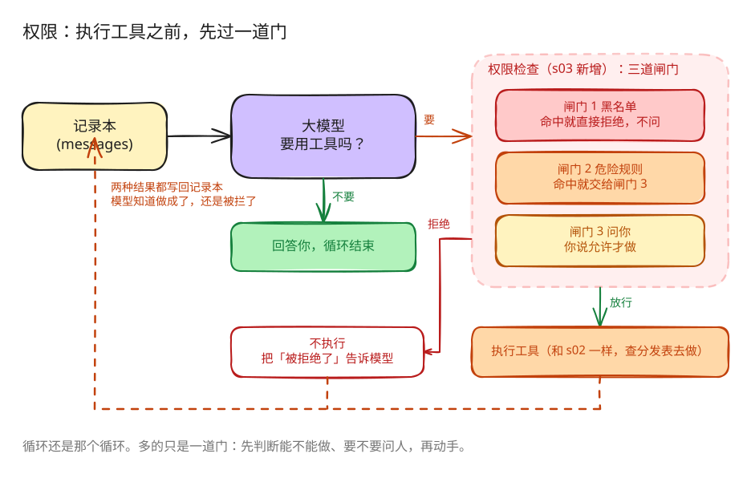
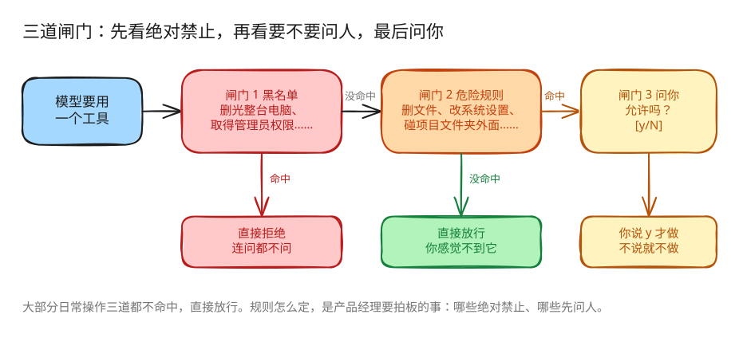

# s03: Permission — 执行前做权限判断

s01 → s02 → `s03` → [s04](../s04_hooks/) → s05 → ... → s16 → s17
> *"工具执行前先做权限判断"* — 权限管线决定哪些操作需要审批。
>
> **Harness 层**: 权限 — 在工具执行前加一道门。

---

## 本章要学会的判断

- **它解决什么**：Agent 动手之前，先判断这件事能不能做、要不要先问人。
- **什么时候需要它**：有不可撤销、花钱或对外的操作：删数据、发邮件、付款、对客户说话。
- **你要拍板的规则**：三档清单：直接放行 / 先问人 / 绝对禁止；谁有权批准；被拒绝后怎么告诉用户。

> 代码看不懂可以先跳过，到网页上看「回放」动画。详细的判断方法在本章末尾的「产品经理视角」。

### 本章新词

每章最多三个新词。看不懂的其他词，去[名词表](../guide/glossary.md)查。

| 词 | 意思 | 比喻 |
|---|---|---|
| 黑名单 | 永远不许做的事的清单，命中就直接拒绝，连问都不问 | 公司规定实习生绝对不能碰公章 |
| 危险命令 | 做了就收不回来的操作，比如删文件、改系统设置 | 把合同原件扔进碎纸机 |
| 项目文件夹（工作区） | Agent 被允许活动的那个文件夹，出了这个范围就要先问人 | 实习生只能进自己部门的办公室 |

---

## 问题

s02 的 Agent 已经有 5 个工具。其中读文件、写文件的工具只能碰项目文件夹里的东西，出了文件夹就会被拦下。但「执行命令」这个工具没有任何限制：你随口说一句「清理一下项目」，它可能真的执行一条把整台电脑的文件全部删光的命令。

模型不可靠，所以安全边界不能靠模型自觉，要由程序负责，而且判断要发生在工具执行之前。

---

## 解决方案



s02 的循环完全保留。唯一的变动是在执行工具之前插入一道权限检查。每个工具调用依次经过三道闸门：先看是不是绝对禁止，再看要不要问人，都没命中就放行。

三道闸门对应三种决策：

| 闸门 | 作用 | 命中后 |
|------|------|--------|
| 1. 黑名单 | 永远禁止的操作：删光整台电脑、取得管理员权限 | 直接拒绝，不执行 |
| 2. 规则匹配 | 看情况的操作：读写项目文件夹外面的文件、删文件 | 交给闸门 3 |
| 3. 用户审批 | 闸门 2 命中后，暂停等用户确认 | 用户决定允许或拒绝 |

三道都没命中 → 直接执行。大部分日常操作走这条路。

---

## 工作原理



**闸门 1**：一张硬拒绝表，先查，命中就返回阻止信息。规则按「要执行的程序名」匹配，而不是看命令里有没有某几个字：`sudo rm x` 会被拦，`grep reboot` 不会。但它仍然只是一张清单，守不住什么，见本章末尾「产品经理视角」。

```python
DENY_LIST = ["sudo", "shutdown", "reboot", "mkfs", "dd", "rm -rf /"]
DESTRUCTIVE = ["rm", "rmdir", "chmod", "git clean", "-delete", "rmtree(", "| sh", "| bash", "> /etc/"]

def command_names(command: str) -> list[str]:
    """按 ; && || | 把一行拆成子命令，取每条的第一个词：真正要执行的程序名。"""
    names = []
    for segment in re.split(r"\|\||&&|[;|]", command):
        words = segment.split()
        if words:
            program = words[0].rsplit("/", 1)[-1]
            names.append(program.split(".")[0] or program)
    return names

def matches_rule(command: str, rule: str) -> bool:
    """一个单词的规则按程序名匹配（grep reboot 不算 reboot）；其余规则按压掉多余空白后的字面匹配。"""
    if rule.isalnum():
        return rule in command_names(command)
    return rule in " ".join(command.split())

def check_deny_list(command: str) -> str | None:
    for pattern in DENY_LIST:
        if matches_rule(command, pattern):
            return f"已拦截：'{pattern}' 在黑名单里"
    return None
```

`sudo`、`rm` 这类单个词的规则，只看每条子命令的第一个词，也就是真正要执行的程序。`cd /tmp && sudo rm x` 拆成 `cd` 和 `sudo` 两条，命中；`cat README.md | grep reboot` 拆成 `cat` 和 `grep`，不命中。`rm -rf /`、`-delete` 这类带符号的规则按字面匹配，多余的空格和 Tab 先压掉，`rm<Tab>-rf` 也逃不掉。

**闸门 2**负责规则匹配，用来描述"什么时候需要问用户"。每条规则指定工具和检查条件。

```python
PERMISSION_RULES = [
    {
        "tools": ["read_file", "write_file", "edit_file"],
        "check": lambda args: not (WORKDIR / args.get("path", "")).resolve().is_relative_to(WORKDIR),
        "message": "要访问工作区以外的路径",
    },
    {
        "tools": ["bash"],
        "check": lambda args: any(matches_rule(args.get("command", ""), rule) for rule in DESTRUCTIVE),
        "message": "可能有破坏性的命令",
    },
]

def check_rules(tool_name: str, args: dict) -> str | None:
    for rule in PERMISSION_RULES:
        if tool_name in rule["tools"] and rule["check"](args):
            return rule["message"]
    return None
```

**闸门 3**：规则命中后，暂停等用户输入。

```python
def ask_user(tool_name: str, args: dict, reason: str) -> str:
    print(f"\n⚠  {reason}")
    print(f"   工具：{tool_name}({args})")
    choice = input("   允许执行吗？[y/N] ").strip().lower()
    return "allow" if choice in ("y", "yes") else "deny"
```

**三道闸门串在一起**，插在工具执行之前：

```python
def check_permission(block) -> bool:
    # 闸门 1: 硬拒绝
    if block.name == "bash":
        reason = check_deny_list(block.input.get("command", ""))
        if reason:
            print(f"\n⛔ {reason}")
            return False

    # 闸门 2 + 3: 规则匹配 → 用户审批
    reason = check_rules(block.name, block.input)
    if reason:
        decision = ask_user(block.name, block.input, reason)
        if decision == "deny":
            return False

    return True

# 在 agent_loop 中——s02 的循环只加了一行：
for block in tool_calls:
    if not check_permission(block):           # ← 新增
        results.append({... "content": "权限被拒绝，没有执行。"})
        continue
    output = TOOL_HANDLERS[block.name](**block.input)  # s02 原有
    results.append(...)
```

---

## 相对 s02 的变更

| 组件 | 之前 (s02) | 之后 (s03) |
|------|-----------|-----------|
| 安全模型 | 无（信任模型） | 三道闸门权限管线 |
| 新函数 | — | command_names, matches_rule, check_deny_list, check_rules, ask_user, check_permission |
| 循环 | 直接执行所有工具 | 执行前插入 check_permission() |

---

## 试一下

```sh
cd claude-code-harness-study
python s03_permission/code.py
```

试试这些话：

1. `在当前文件夹新建一个 test.txt`（在项目文件夹里写文件，直接通过）
2. `删除 test.txt 这个文件`（删文件是危险命令，触发闸门 2，停下来问你）
3. `当前文件夹里有哪些文件？`（只读，直接通过）
4. `往系统设置目录 /etc 里写一个文件`（写到项目文件夹外面，触发闸门 2）
5. `把 README.md 里提到 reboot 的那几行找出来给我`（命令里有「重启」的字样，但真正执行的只是查找，直接通过）
6. `用 find 命令把这个文件夹下所有 .pyc 文件删掉`（换了一种删除写法，没有 rm 字样，也触发闸门 2）

观察重点：哪些操作直接通过？哪些需要你确认？哪些被直接拒绝？

---

## 产品经理视角

> 模型一定会出错，权限决定它出错时会闯多大的祸。这是产品经理最不能交给工程师单独决定的组件。

### 什么信号说明需要它

- Agent 能做不可撤销的事：删除、付款、发邮件、对外发布。
- Agent 能接触敏感数据：客户信息、薪资、合同。
- Agent 会读外部内容，比如网页、邮件、上传的文档。这些内容里可能藏着诱导它做坏事的指令，这类攻击叫「提示词注入」。

### 代价

- **打断用户**：每次确认都会打断用户。确认太多，用户就会不看内容直接点「同意」，权限形同虚设。
- **两头为难**：规则太严，Agent 什么都做不了；太松，等于没有。
- **要持续维护**：每上线一个新工具，就要补一条规则。

### 这套规则守不住什么

本章的黑名单和危险规则是一张「关键词清单」，只能挡住写在清单上的那几种写法：

- 换一种写法就绕过去了。删文件在电脑上有十几种写法，本章把常见的几种补进了清单，但清单上没有的写法都会放行，先把命令写进一个脚本再执行也能绕过。清单永远追不上写法。
- 模型不是故意绕，它只是换了个顺手的写法。网页、邮件里如果藏着指令（提示词注入），模型也可能照做。
- 所以关键词清单只是最后一道提醒，真正的边界要靠下面这些更便宜也更可靠的办法：只给只读工具、在沙箱或测试账号里跑、让操作可撤销。结论卡里写「越权次数目标为 0」时，要写清楚靠的是哪一层，不能只靠一张清单。

### 先试试更便宜的办法

- 只给只读工具。
- 在隔离环境里跑，比如沙箱、测试账号，做错了也不影响真实数据。
- 用可撤销的操作代替不可撤销的：先放进回收站而不是直接删除，先存草稿而不是直接发送。

### 你要拍板的规则

核心是一张三档清单，正好对应本章的三道闸门：

| 档位 | 含义 | 示例（电商客服 Agent） |
|---|---|---|
| **直接放行** | 只读、可撤销、影响小 | 查订单、查物流 |
| **先问人** | 会改变外部世界，但有时必须做 | 200 元以内的退款、修改收货地址 |
| **绝对禁止** | 后果严重，任何情况都不允许 | 修改价格、导出全部客户数据、超过上限的退款 |

另外还要定：

- 谁有权批准，是用户本人还是主管。
- 被拒绝后，Agent 怎么跟用户解释。
- 规则多久复查一次。

### 怎么衡量

- **越权、误操作次数**：目标是 0。
- **确认的通过率**：如果某类操作的通过率接近 100%，说明问得太多，用户已经不看了。这类操作如果可以撤销，可以考虑降档。
- **被拒绝后，任务最终有没有完成**。

### 真实产品里的样子

- Claude Code 有几种权限模式：默认在改文件、执行命令前询问；可以设成自动接受改文件；也可以只出计划、不动手。企业管理员还能统一下发「允许、询问、禁止」三类规则，和本章的三道闸门一一对应。
- ChatGPT 的 Agent 模式在执行购买这类有后果的操作前，会先请用户确认。
- Cursor 让用户自己设置哪些命令可以自动执行、哪些必须先问。

### 面试题

**「确认弹窗太多，用户嫌烦，你怎么办？」**

答题要点：

- 不能简单地全部放开。
- 先看数据：哪些操作的确认通过率接近 100%，而且可以撤销？这些可以降为直接放行。
- 把「事后撤销」做成默认，用撤销按钮代替事前确认。
- 合并确认：先给出整个计划，让用户一次确认。
- 高风险操作保持确认，必要时还要二次确认。

> 16 个组件的判断卡放在一起比较，见 [选型篇](../guide/README.md)。

---

## 接下来

现在权限检查是直接写在循环里的。如果还想在每次工具执行前后记一笔日志？想在某些操作之后自动备份？每加一项都要去改循环本身，循环很快就会越来越胖。

s04 钩子（Hooks）→ 给循环加钩子，扩展逻辑挂在钩子上，循环保持干净。
