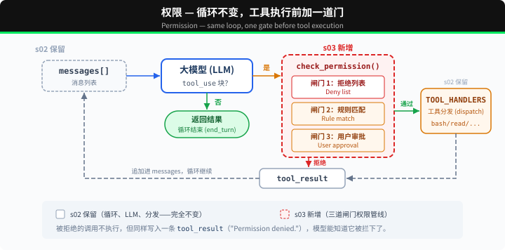
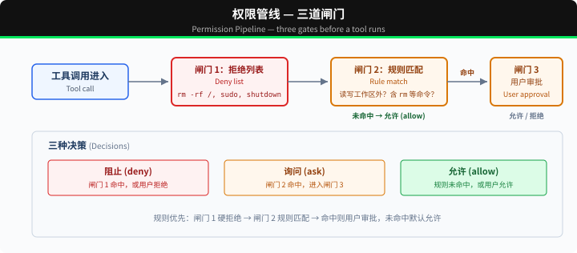

# s03: Permission — 执行前做权限判断

s01 → s02 → `s03` → [s04](../s04_hooks/) → s05 → ... → s16 → s17
> *"工具执行前先做权限判断"* — 权限管线决定哪些操作需要审批。
>
> **Harness 层**: 权限 — 在工具执行前加一道门。

---

## 本章要学会的判断

- **它解决什么**：Agent 动手之前，先判断这件事能不能做、要不要先问人。
- **什么时候需要它**：有不可撤销、花钱或对外的操作：删数据、发邮件、付款、对客户说话。
- **你要拍板的规则**：三档清单：直接放行 / 先问人 / 绝对禁止；谁有权批准；被拒绝后怎么告诉用户。

> 代码看不懂可以先跳过，到网页上看「回放」动画。详细的判断方法在本章末尾的「产品经理视角」。

---

## 问题

s02 的 Agent 有 5 个工具。file tools 受 `safe_path` 保护，但 bash 不受限制。让它"清理一下项目"，可能执行 `rm -rf /`。

安全边界由代码负责，判断发生在工具执行之前。

---

## 解决方案



s02 的循环完全保留。唯一的变动是在工具执行前插入 `check_permission()`。每个工具调用依次经过三道闸门：硬拒绝优先，软询问次之，都没命中就放行。

三道闸门对应三种决策：

| 闸门 | 作用 | 命中后 |
|------|------|--------|
| 1. 拒绝列表 | 永远禁止的操作（`rm -rf /`、`sudo`） | 直接拒绝，不执行 |
| 2. 规则匹配 | 取决于上下文的操作（读/写工作区外、`rm` 文件） | 交给闸门 3 |
| 3. 用户审批 | 闸门 2 命中后，暂停等用户确认 | 用户决定允许或拒绝 |

三道都没命中 → 直接执行。大部分日常操作走这条路。

---

## 工作原理



**闸门 1**：一张硬拒绝表，先查，命中就返回阻止信息。这张表使用简单字符串匹配来说明权限闸门的位置，不能视为完整的安全边界。

```python
DENY_LIST = [
    "rm -rf /", "sudo", "shutdown", "reboot",
    "mkfs", "dd if=", "> /dev/sda",
]

def check_deny_list(command: str) -> str | None:
    for pattern in DENY_LIST:
        if pattern in command:
            return f"已拦截：'{pattern}' 在黑名单里"
    return None
```

**闸门 2**负责规则匹配，用来描述"什么时候需要问用户"。每条规则指定工具和检查条件。

```python
PERMISSION_RULES = [
    {
        "tools": ["read_file", "write_file", "edit_file"],
        "check": lambda args: not (WORKDIR / args.get("path", "")).resolve().is_relative_to(WORKDIR),
        "message": "要访问工作区以外的路径",
    },
    {
        "tools": ["bash"],
        "check": lambda args: any(kw in args.get("command", "") for kw in ["rm ", "> /etc/", "chmod 777"]),
        "message": "可能有破坏性的命令",
    },
]

def check_rules(tool_name: str, args: dict) -> str | None:
    for rule in PERMISSION_RULES:
        if tool_name in rule["tools"] and rule["check"](args):
            return rule["message"]
    return None
```

**闸门 3**：规则命中后，暂停等用户输入。

```python
def ask_user(tool_name: str, args: dict, reason: str) -> str:
    print(f"\n⚠  {reason}")
    print(f"   工具：{tool_name}({args})")
    choice = input("   允许执行吗？[y/N] ").strip().lower()
    return "allow" if choice in ("y", "yes") else "deny"
```

**三道闸门串在一起**，插在工具执行之前：

```python
def check_permission(block) -> bool:
    # 闸门 1: 硬拒绝
    if block.name == "bash":
        reason = check_deny_list(block.input.get("command", ""))
        if reason:
            print(f"\n⛔ {reason}")
            return False

    # 闸门 2 + 3: 规则匹配 → 用户审批
    reason = check_rules(block.name, block.input)
    if reason:
        decision = ask_user(block.name, block.input, reason)
        if decision == "deny":
            return False

    return True

# 在 agent_loop 中——s02 的循环只加了一行：
for block in tool_calls:
    if not check_permission(block):           # ← 新增
        results.append({... "content": "权限被拒绝，没有执行。"})
        continue
    output = TOOL_HANDLERS[block.name](**block.input)  # s02 原有
    results.append(...)
```

---

## 相对 s02 的变更

| 组件 | 之前 (s02) | 之后 (s03) |
|------|-----------|-----------|
| 安全模型 | 无（信任模型） | 三道闸门权限管线 |
| 新函数 | — | check_deny_list, check_rules, ask_user, check_permission |
| 循环 | 直接执行所有工具 | 执行前插入 check_permission() |

---

## 试一下

```sh
cd learn-claude-code
python s03_permission/code.py
```

试试这些 prompt：

1. `Create a file called test.txt in the current directory`（应该直接通过）
2. `Delete the file test.txt`（bash + rm 会触发闸门 2）
3. `What files are in the current directory?`（只读，全部通过）
4. `Try to write a file to /etc/something`（写工作区外，触发闸门 2）

观察重点：哪些操作直接通过？哪些需要你确认？哪些被直接拒绝？

---

## 产品经理视角

> 模型一定会出错，权限决定它出错时会闯多大的祸。这是产品经理最不能交给工程师单独决定的部件。

### 什么信号说明需要它

- Agent 能做不可撤销的事：删除、付款、发邮件、对外发布。
- Agent 能接触敏感数据：客户信息、薪资、合同。
- Agent 会读外部内容，比如网页、邮件、上传的文档。这些内容里可能藏着诱导它做坏事的指令，这类攻击叫「提示词注入」。

### 代价

- **打断用户**：每次确认都会打断用户。确认太多，用户就会不看内容直接点「同意」，权限形同虚设。
- **两头为难**：规则太严，Agent 什么都做不了；太松，等于没有。
- **要持续维护**：每上线一个新工具，就要补一条规则。

### 先试试更便宜的办法

- 只给只读工具。
- 在隔离环境里跑，比如沙箱、测试账号，做错了也不影响真实数据。
- 用可撤销的操作代替不可撤销的：先放进回收站而不是直接删除，先存草稿而不是直接发送。

### 你要拍板的规则

核心是一张三档清单，正好对应本章的三道闸门：

| 档位 | 含义 | 示例（电商客服 Agent） |
|---|---|---|
| **直接放行** | 只读、可撤销、影响小 | 查订单、查物流 |
| **先问人** | 会改变外部世界，但有时必须做 | 200 元以内的退款、修改收货地址 |
| **绝对禁止** | 后果严重，任何情况都不允许 | 修改价格、导出全部客户数据、超过上限的退款 |

另外还要定：

- 谁有权批准，是用户本人还是主管。
- 被拒绝后，Agent 怎么跟用户解释。
- 规则多久复查一次。

### 怎么衡量

- **越权、误操作次数**：目标是 0。
- **确认的通过率**：如果某类操作的通过率接近 100%，说明问得太多，用户已经不看了。这类操作如果可以撤销，可以考虑降档。
- **被拒绝后，任务最终有没有完成**。

### 真实产品里的样子

- Claude Code 有几种权限模式：默认在改文件、执行命令前询问；可以设成自动接受改文件；也可以只出计划、不动手。企业管理员还能统一下发「允许、询问、禁止」三类规则，和本章的三道闸门一一对应。
- ChatGPT 的 Agent 模式在执行购买这类有后果的操作前，会先请用户确认。
- Cursor 让用户自己设置哪些命令可以自动执行、哪些必须先问。

### 面试题

**「确认弹窗太多，用户嫌烦，你怎么办？」**

答题要点：

- 不能简单地全部放开。
- 先看数据：哪些操作的确认通过率接近 100%，而且可以撤销？这些可以降为直接放行。
- 把「事后撤销」做成默认，用撤销按钮代替事前确认。
- 合并确认：先给出整个计划，让用户一次确认。
- 高风险操作保持确认，必要时还要二次确认。

> 16 个部件的判断卡放在一起比较，见 [选型篇](../guide/README.md)。

---

## 接下来

当前权限检查每次都在循环里硬编码 `check_permission()`。如果我想在每次工具执行前后加日志？如果想在某些操作后自动触发 git commit？这些扩展逻辑散落在 loop 里，循环很快就会膨胀。

s04 Hooks → 给循环加钩子，扩展逻辑挂在钩子上，循环保持干净。


<!-- translation-sync: zh@v1, en@v1, ja@v1 -->
