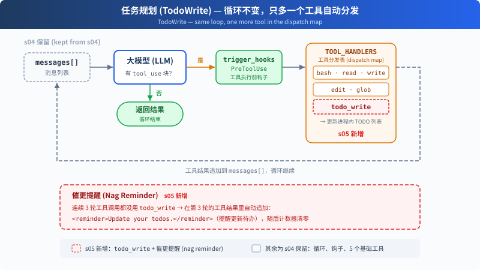

# s05: TodoWrite — 没有计划的 Agent，做着做着就偏了

s01 → s02 → s03 → s04 → `s05` → [s06](../s06_subagent/) → s07 → ... → s16 → s17

> *"没有计划的 agent 走哪算哪"* — 先列步骤再动手，长任务更不容易漏项。
>
> **Harness 层**: 规划 — 让 Agent 在动手之前先想清楚。

---

## 问题

给 Agent 一个复杂任务："把所有 Python 文件改成 snake_case 命名，然后跑测试，修好失败。"

Agent 开始干活，改了 3 个文件，跑了个测试，发现 2 个失败，开始修。修着修着，它忘了最初是"改成 snake_case"，测试失败把注意力全吸走了。

对话越长越严重：工具结果不断填满上下文，系统提示的影响力被稀释。一个 10 步重构，做完 1-3 步就开始即兴发挥，因为 4-10 步已经被挤出注意力了。

---

## 解决方案



S05 保留 S04 的工具分发、权限检查和 Hooks，再加入 `todo_write` 与 reminder 计数器。`todo_write` 只更新计划状态，实际工作仍由原有工具完成。

新工具仍通过 `TOOL_HANDLERS[block.name]` 分发。连续三个工具调用轮次没有使用 `todo_write` 时，Harness 会把 reminder 追加到第三轮的工具结果中。

---

## 工作原理

**TodoManager** 持有内存中的任务列表，负责校验更新，并把渲染结果返回给模型。`run_todo_write` 同时把这份状态打印到终端：

```python
class TodoManager:
    def __init__(self):
        self.items = []

    def update(self, todos: list | str) -> str:
        # Parse and validate before replacing the current list.
        validated = []
        ...
        self.items = validated
        return self.render()

    def render(self) -> str:
        # [ ] pending, [>] in progress, [x] completed
        ...


TODO = TodoManager()

def run_todo_write(todos: list | str) -> str:
    output = TODO.update(todos)
    print(output)
    return output
```

一次更新最多包含 20 项；每项都必须有非空的 `content`；同一时间只能有一个 `in_progress`。字符串输入可以是 JSON，也可以是 Python 列表表示，解析过程不使用 `eval`。

工具定义和其他 5 个工具一起加入 dispatch map：

```python
TOOLS = [
    {"name": "bash",       ...},
    {"name": "read_file",  ...},
    {"name": "write_file", ...},
    {"name": "edit_file",  ...},
    {"name": "glob",       ...},
    # s05: 新增一条
    {"name": "todo_write", "description": "Create and manage a task list ...",
     "input_schema": {
         "type": "object",
         "properties": {
             "todos": {
                 "type": "array",
                 "items": {
                     "type": "object",
                     "properties": {
                         "content": {"type": "string"},
                         "status": {"type": "string", "enum": ["pending", "in_progress", "completed"]},
                     },
                 },
             },
         },
     },
    },
]

TOOL_HANDLERS["todo_write"] = run_todo_write
```

**Reminder**：连续三个工具调用轮次没有使用 `todo_write` 时，reminder 会追加到第三轮的结果中，随后计数器清零：

```python
rounds_since_todo = 0 if used_todo else rounds_since_todo + 1
if rounds_since_todo >= 3:
    results.append({
        "type": "text",
        "text": "<reminder>Update your todos.</reminder>",
    })
    rounds_since_todo = 0
```

Agent 收到任务后的典型流程：先调 `todo_write` 列出所有步骤（全 `pending`）→ 做一个步骤，改成 `in_progress` → 做完改成 `completed` → 看下一个 `pending` → 继续。

**关键洞察**：todo_write 不给 Agent 增加任何**执行能力**。它增加的是**规划能力**。

---

## 相对 s04 的变更

| 组件 | 之前 (s04) | 之后 (s05) |
|------|-----------|-----------|
| 工具数量 | 5 (bash, read, write, edit, glob) | 6 (+todo_write) |
| 规划能力 | 无 | 带状态的 TODO 列表 + reminder |
| SYSTEM 提示 | 通用提示 | 加入 "先计划再执行" 引导 |
| 循环 | 工具分发与 Hooks | 保留分发路径，加入 rounds_since_todo 和 reminder 注入 |

---

## 试一下

```sh
cd learn-claude-code
python s05_todo_write/code.py
```

试试这些 prompt：

1. `Refactor s05_todo_write/example/hello.py: add type hints, docstrings, and a main guard`（先列 3 步再执行）
2. `Create a Python package under s05_todo_write/example/demo_pkg with __init__.py, utils.py, and tests/test_utils.py`
3. `Review Python files under s05_todo_write/example and fix any style issues`

观察重点：第一次工具调用是不是 `todo_write`？TODO 列了几步？执行过程中状态有没有从 `pending` 变成 `in_progress` / `completed`？

---

## 产品经理视角

> 让 Agent 先列计划再动手，长任务就不容易跑偏、漏项。计划还能展示给用户，让等待变得可预期。

### 什么信号说明需要它

- 任务超过五到十步。
- 用户反馈「做着做着忘了最初的要求」「漏了几项」。
- 长时间等待时，用户不知道 Agent 在干什么、做到哪了。

### 代价

- **更慢、更贵**：每更新一次计划，都要多花一点时间和费用。
- **计划可能列错**：列错了还严格执行，比没有计划更糟。
- **显得啰嗦**：简单任务也列计划，用户会觉得多余。

### 先试试更便宜的办法

- 让用户自己把大任务拆成几次小请求。
- 在提示词里要求模型「先说思路再动手」，不维护一份正式的清单。

### 你要拍板的规则

| 规则 | 示例 |
|---|---|
| 多复杂才要列计划 | 预计超过 5 步的任务必须先列 |
| 计划要不要用户先确认 | 要改动多处数据时，先给用户看计划，确认后再动手 |
| 计划怎么展示 | 界面上显示清单和进度，完成一项打一个勾 |
| 中途能不能改计划 | 可以改，但要告诉用户改了什么 |

### 怎么衡量

- **漏项率**：任务完成后，用户补一句「还有某某没做」的比例。
- **计划和实际的偏差**：实际做的和最初列的差多少。
- **长任务的中途放弃率**：用户能看到进度以后，放弃率应该下降。

### 真实产品里的样子

- Claude Code 做复杂任务时，会在界面上列出待办清单，边做边打勾，用的就是本章的机制。
- Manus 团队在公开的经验总结里提到，他们的 Agent 会创建一份 todo.md，执行中不断更新，目的是让模型一直记得目标。
- Kiro 这类工具在动手前先生成需求、设计和任务清单，请用户确认。「先计划再执行」本身就成了产品卖点。

### 面试题

**「Agent 做长任务经常漏步骤，怎么改进？」**

答题要点：

- 先分清症状：是漏项、跑偏，还是半路就停了。
- 漏项和跑偏：加计划清单，并定期提醒模型回看计划。
- 把计划展示给用户；复杂任务先请用户确认。
- 用漏项率衡量改进效果。
- 如果是半路停下、却自称做完了，那是 s17 要解决的问题。

> 17 个部件的判断卡放在一起比较，见 [选型篇](../guide/README.md)。

---

## 接下来

Agent 能计划了。但如果一个任务太大，比如"重构整个认证模块"，光靠 TODO 列表不够。这个任务本身就是几十个小任务的集合，放在同一个对话里会被上下文淹没。

s06 Subagent → 把大任务拆成子任务，每个子任务派一个独立的 Agent。它们有自己的干净上下文，不会互相污染。


<!-- translation-sync: zh@v1, en@v1, ja@v1 -->
