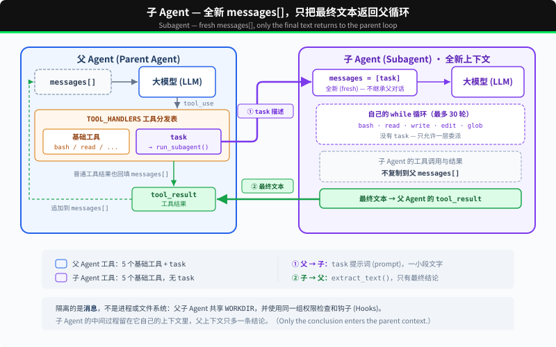

# s06: Subagent — 给子任务一段独立上下文

s01 → s02 → s03 → s04 → s05 → `s06` → [s07](../s07_skill_loading/) → s08 → ... → s16 → s17

> Subagent 从全新的 `messages[]` 开始。最终文本返回父循环，中间对话不会进入父上下文。
>
> **Harness 层**: 委派 — 在另一段对话上下文中处理一个明确的子任务。

---

## 问题

Agent 在修一个 bug。为了追踪调用链，它读取了许多文件；每次工具调用和结果都会留在父循环的 `messages[]` 中。调用链已经弄清以后，多数中间细节不再需要，却仍然占用上下文。

---

## 解决方案



调用 `task` 时，会同步运行一个使用全新 `messages[]` 的嵌套 Agent Loop。循环结束后，它的最终文本会成为父对话中的工具结果。

这里隔离的是消息，不是进程或文件系统。父 Agent 与子 Agent 共享 `WORKDIR`，写文件和命令仍会影响同一个工作区。子 Agent 拥有五个基础工具，但没有 `task`；它的工具调用与父 Agent 使用同一组权限和生命周期 Hooks。

---

## 工作原理

**run_subagent** 创建新的消息列表，运行嵌套循环，并返回最终文本：

```python
SUB_TOOLS = list(BASE_TOOLS)  # no task tool

def run_subagent(prompt: str) -> str:
    messages = [{"role": "user", "content": prompt}]

    for _ in range(30):
        response = client.messages.create(
            model=MODEL, system=SUB_SYSTEM,
            messages=messages, tools=SUB_TOOLS, max_tokens=8000,
        )
        messages.append({"role": "assistant", "content": response.content})
        tool_calls = [
            block for block in response.content if block.type == "tool_use"
        ]
        if not tool_calls:
            return extract_text(response.content) or "(no summary)"

        results = []
        for block in tool_calls:
            output = execute_tool(block, SUB_HANDLERS)
            results.append({... "content": output})
        messages.append({"role": "user", "content": results})

    return "Subagent stopped after 30 turns without a final answer."
```

主 Agent 调用时，跟调其他工具一样：

```python
TASK_TOOL = {
    "name": "task",
    "description": "Run a subagent with fresh conversation context and return its final text.",
    "input_schema": {
        "type": "object",
        "properties": {"prompt": {"type": "string"}},
        "required": ["prompt"],
    },
}

TOOLS = [*BASE_TOOLS, TASK_TOOL]
TOOL_HANDLERS = {**BASE_HANDLERS, "task": run_subagent}
```

实际边界如下：

| 决策 | 选择 | 原因 |
|------|------|------|
| 对话 | 全新的 `messages[]` | 不把父对话复制给子 Agent |
| 执行 | 同一进程和 `WORKDIR` | 两个循环都能看到文件系统修改 |
| 返回值 | 只返回最终文本 | 子 Agent 的工具调用和结果不进入父消息列表 |
| 委派深度 | `SUB_TOOLS` 中没有 `task` | 本章只允许一层委派 |
| 工具策略 | 共享 Hooks | 父子循环使用相同的权限检查 |

父 Agent 与其他工具一样，通过 handler map 分发 `task`。子 Agent 使用 `SUB_SYSTEM`、`SUB_TOOLS` 和自己的局部 `messages` 列表。

---

## 试一下

```sh
cd learn-claude-code
python s06_subagent/code.py
```

试试这些 prompt：

1. `Use a subtask to find what testing framework this project uses`（子 Agent 去读文件，主 Agent 只收结论）
2. `Delegate: read all .py files in s01_agent_loop/ and summarize what each one does`
3. `Use a task to create s06_subagent/example/string_tools.py with a slugify(text: str) function, then verify it from the parent agent`

观察重点：是否出现 `[Subagent started]` / `[Subagent done]`？子 Agent 的工具调用是否以 `[sub] ...` 输出？父 Agent 是否只接收到 `task` 返回的最终文本？

---

## 产品经理视角

> 把「要读一大堆资料、最后只要一个结论」的活派给子 Agent，主对话只收结论，不会被过程挤满。

### 什么信号说明需要它

- 某个子任务要翻大量资料，比如搜几十个文件、读十几篇文档，但最后只需要一个结论。
- 主对话被这些过程资料挤满，开始忘事、变慢、变贵。
- 几块调研互不依赖，可以分开做。

### 代价

- **更贵**：多一轮甚至多轮模型调用，总费用会增加。
- **容易跑偏**：子 Agent 看不到主对话，任务交代不清，它就会做偏，或者做重复的工作。
- **难排查**：出了错，要沿着主 Agent、子 Agent 一层层往下查。
- **权限不能放松**：本章的子 Agent 和主 Agent 共用同一个工作区，它写的文件、执行的命令同样会生效。

### 先试试更便宜的办法

- 资料不多：主 Agent 自己做完。
- 先试试压缩（s08）。

### 你要拍板的规则

| 规则 | 示例 |
|---|---|
| 什么任务能派出去 | 只派调研、搜索、阅读这类；改东西的活留给主 Agent |
| 子 Agent 能用哪些工具 | 默认只读 |
| 最多派几个、预算多少 | 一次最多 3 个，每个不超过主任务预算的 20% |
| 结论按什么格式交回 | 结论 + 依据出处 + 没查到的部分 |

### 怎么衡量

- 主对话的长度和费用有没有下降。
- 子 Agent 交回的结论准不准（抽查）。
- 总费用：如果总费用明显上升，质量却没有提升，就不值得。

### 真实产品里的样子

- Claude Code 会把搜索代码库这类任务派给子 Agent。用户也可以自定义专门的子 Agent，比如「代码审查员」，给它单独的说明和工具范围。
- Anthropic 公开过自家深度研究功能的做法：主 Agent 拆分问题，派多个子 Agent 并行搜索，最后汇总。他们也公布了代价：这种多 Agent 方式消耗的 token 大约是普通聊天的 15 倍。

### 面试题

**「什么情况下你会让 Agent 派子 Agent，什么情况下不会？」**

答题要点：

- 会：子任务资料多、结论小，而且彼此独立。
- 不会：任务需要频繁来回沟通；上下文本来就够用；要改东西的任务（容易互相冲突）。
- 代价是费用和排查难度。
- 用主对话长度、总费用和结论准确率来衡量值不值。

> 17 个部件的判断卡放在一起比较，见 [选型篇](../guide/README.md)。

---

## 接下来

Agent 现在能拆任务了。但每个任务需要的知识不一样：改 Python 脚本需要知道 PEP 8 规范，写 SQL 需要知道表结构。这些知识全塞进 system prompt，上下文直接爆了。

s07 Skill Loading → 技能按需注入，不在 system prompt 里堆文档。用到的时候才加载，和读文件一样自然。


<!-- translation-sync: zh@v2, en@v2, ja@v2 -->
