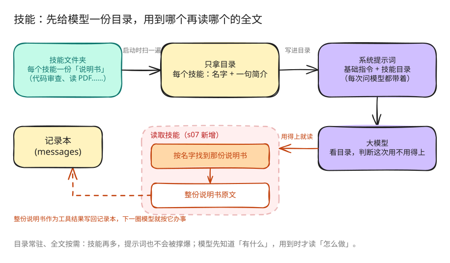

# s07: Skill Loading — 用到时再加载

s01 → s02 → s03 → s04 → s05 → s06 → `s07` → [s08](../s08_context_compact/) → s09 → ... → s16 → s17

> system prompt 保存技能目录；`load_skill` 返回完整的 `SKILL.md`。
>
> **Harness 层**：知识加载 — 让模型先知道有哪些技能，再按名称读取内容。

---

## 本章要学会的判断

- **它解决什么**：有好几套专门的操作规范时，先只给模型看目录，用到哪套再展开哪套。
- **什么时候需要它**：规范一多，全塞进提示词太长，还会互相干扰。
- **你要拍板的规则**：技能由谁写、谁审、多久更新；目录里的描述怎么写，模型才会在对的时候用上。

> 代码看不懂可以先跳过，到网页上看「回放」动画。详细的判断方法在本章末尾的「产品经理视角」。

### 本章新词

每章最多三个新词。看不懂的其他词，去[名词表](../guide/glossary.md)查。

| 词 | 意思 | 比喻 |
|---|---|---|
| 技能 | 一份写给 Agent 的操作说明书，放在一个文件夹里 | 新员工手册里的一章 |
| 技能目录 | 每个技能的名字加一句简介，常驻在系统提示词里 | 手册的目录页 |
| 按需加载 | 用到哪个技能，才读它的全文 | 翻到那一章再细看 |

---

## 问题

假设一个项目有三份规范：前端组件规范、数据库查询风格、接口设计文档。我们希望 Agent 干活时遵守它们，最直接的做法是把三份全文都塞进系统提示词。

能用，但有个问题：每次问模型都把三份全带上。当前任务只改前端时，真正需要的只有前端那份，另外两份白占地方，留给代码、对话和工具结果的空间就少了。

---

## 解决方案



启动时，程序扫一遍技能文件夹，只拿每个技能的名字和一句简介，拼成一份目录放进系统提示词。模型判断某个技能用得上时，调用「读取技能」工具，整份说明书作为工具结果写回记录本。

| 内容 | 放在哪里 | 什么时候加进去 |
|------|----------|----------------|
| 技能的名字和简介 | 系统提示词 | 启动时就有 |
| 整份说明书 | 工具结果 | 模型点名要读时 |

---

## 工作原理

每个技能是一个包含 `SKILL.md` 的目录：

```text
skills/
  agent-builder/SKILL.md
  code-review/SKILL.md
  mcp-builder/SKILL.md
  pdf/SKILL.md
```

### 扫描技能

```python
class SkillLoader:
    def scan(self):
        self.skills.clear()
        skills_root = self.skills_dir.resolve()
        for manifest in sorted(self.skills_dir.glob("*/SKILL.md")):
            if (not manifest.is_file()
                    or not manifest.resolve().is_relative_to(skills_root)):
                continue
            content = manifest.read_text()
            metadata, body = self.parse_frontmatter(content)
            raw_name = metadata.get("name")
            name = raw_name.strip() if isinstance(raw_name, str) else ""
            name = name or manifest.parent.name
            raw_description = metadata.get("description")
            description = (raw_description.strip()
                           if isinstance(raw_description, str) else "")
            description = description or body.split("\n", 1)[0]
            description = " ".join(str(description).lstrip("# ").split())
            self.skills[name] = {
                "name": name,
                "description": description,
                "content": content,
            }
```

`catalog()` 只输出名称和描述：

```text
- code-review: Perform thorough code reviews...
- pdf: Process PDF files...
```

### 组装 system prompt

```python
def build_system_prompt() -> str:
    return (
        f"You are a coding agent at {WORKDIR}. Use tools to solve tasks. "
        "Act, don't explain. Always answer in Chinese.\n\n"
        f"Skills available:\n{SKILL_LOADER.catalog()}\n\n"
        "Use load_skill to read the full instructions when a skill applies."
    )
```

固定的 Agent 指令和扫描得到的技能目录在这里组成实际传给模型的 system prompt。

### 加载完整内容

```python
def load(self, name: str) -> str:
    skill = self.skills.get(name)
    if skill:
        return skill["content"]
    available = ", ".join(self.skills) or "none"
    return f"Error: Unknown skill '{name}'. Available: {available}"
```

`name` 用于查询启动时建立的注册表，不会被当作文件路径。工具返回后，原有 Agent Loop 会把内容作为新的 `tool_result` 消息追加。

---

## 试一下

```sh
cd claude-code-harness-study
python s07_skill_loading/code.py
```

试试这些话：

1. `现在有哪些技能可以用？`
2. `加载「代码审查」技能，按它的要求审查 README.md`
3. `先判断该用哪个技能，加载后再审查 README.md`

观察重点：一开始系统提示词里只有目录；调用读取技能之后，整份说明书才出现在工具结果里。

---

## 产品经理视角

> 技能是把公司的做事规范打包成说明书，Agent 用到时才翻开。这是产品经理和业务专家最容易直接参与的组件：不用写代码，写好文档就行。

### 什么信号说明需要它

- 有好几套专门的规范：报销流程、合同审查口径、品牌文案要求。
- 全部塞进提示词太长，规范之间互相干扰，费用也上去了。
- 业务方经常要改规范，希望不用等工程师发版。

### 代价

- **可能用不上**：模型可能想不起来去翻说明书；目录里的简介写得不好，该用的时候用不上。
- **可能互相矛盾**：技能多了，彼此之间可能冲突。
- **要有人维护**：过期的规范比没有规范更危险。

### 先试试更便宜的办法

- 只有一两套规范：直接写进提示词。

### 你要拍板的规则

| 规则 | 示例 |
|---|---|
| 谁写、谁审 | 业务负责人写，产品经理审格式，法务审合规相关的内容 |
| 多久更新 | 每季度复查一次；制度变了当天更新 |
| 目录里的简介怎么写 | 写清「什么情况下用这一份」，而不是只写个标题 |
| 冲突以谁为准 | 定好优先级，比如法务规范优先于文案风格 |

### 怎么衡量

- 该用技能的时候，实际用上的比例（抽查）。
- 用上技能后，回答符合规范的比例。
- 加载技能前后的费用变化。

### 真实产品里的样子

- Anthropic 在 2025 年推出了 Agent Skills。每个技能是一个文件夹，核心是一份说明书文件。Claude 平时只看到技能的名字和简介，需要时才读全文，和本章的机制一样。
- 这个格式后来公开成开放规范，其他厂商的工具也陆续支持。业务方写好的一份技能，可以在不同工具里复用。

### 面试题

**「公司有几十份操作规范，怎么让 Agent 遵守？」**

答题要点：

- 不要全塞进提示词。
- 做成技能，按需加载；目录简介要写清适用场景。
- 由业务负责人维护，定期复查。
- 规范之间冲突时，定好优先级。
- 用使用率和合规率衡量效果。

> 16 个组件的判断卡放在一起比较，见 [选型篇](../guide/README.md)。

---

## 接下来

工具用得越多，记录本里堆的旧文件内容和旧工具结果就越多。

s08 压缩（Context Compact）→ 给记录本腾地方，让后面的对话还装得下。
