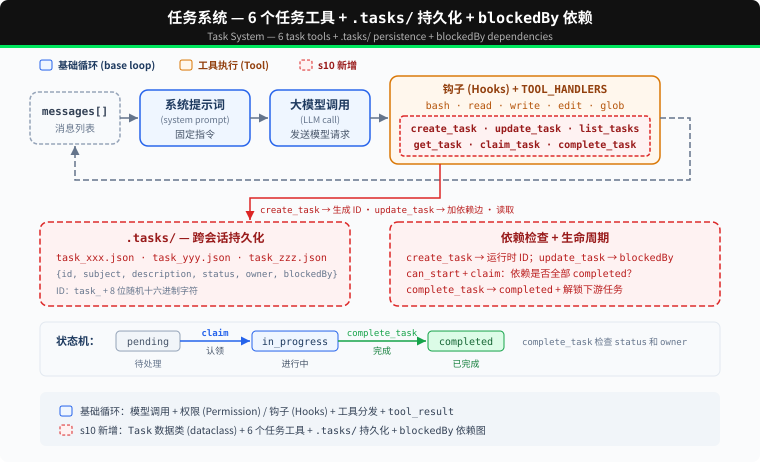
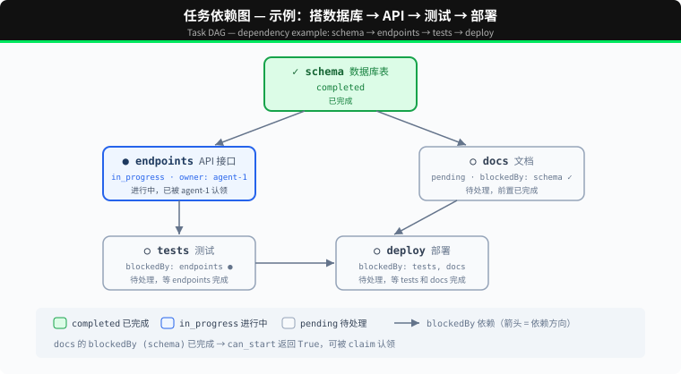

# s10: Task System — 从执行清单到可协调的任务状态

s01 → ... → s08 → s09 → `s10` → [s11](../s11_background_tasks/) → s12 → ... → s16 → s17

> *"大目标拆成小任务, 排好序, 持久化"* — 文件持久化的任务图, 多 agent 协作的基础。
>
> **Harness 层**: 任务 — 持久化的目标, 可恢复的进度。

---

## 问题

s05 的 TodoWrite 让 Agent 记录当前任务的执行步骤。清单中的每一项只有内容和状态，用来提醒 Agent 接下来还要做什么。

当项目被拆成创建数据库表、编写 API 和添加测试三个任务时，Harness 还需要知道它们之间的关系：数据库表完成后才能编写 API，API 接口确定后才能添加测试。每个任务还要记录由谁负责。

TodoWrite 没有记录这些依赖和分工。它可以显示“编写 API”仍未完成，但 Harness 无法据此判断这个任务是否可以开始。

本章加入 Task System。每个任务都有独立的 ID 和状态，`blockedBy` 记录前置任务，`owner` 记录负责执行的 Agent。

---

## 解决方案



代码保留 S04 的五个基础工具、Permission、Hooks 和统一 `execute_tool`，再加入 6 个任务工具、`.tasks/` 目录持久化和 `blockedBy` 依赖检查。

TodoWrite vs Task System：

| | TodoWrite (s05) | Task System (s10) |
|---|---|---|
| 定位 | 当前任务的执行清单 | 可恢复的任务系统 |
| 存储 | 进程内 / 会话状态 | `.tasks/{id}.json` |
| 依赖 | 无 | `blockedBy` 依赖图 |
| 生命周期 | 当前会话 / 当前任务 | 跨会话保留 |
| 分工 | 不负责任务认领 | `owner` / claim |
| 状态 | pending / in_progress / completed | pending / in_progress / completed |
| 粒度 | Agent 自己的步骤 | 可被认领、追踪、解锁的任务 |
| 更新契约 | 整表替换 | 对单条记录执行创建、读取、更新、列举 |

---

## 工作原理



### Task: 数据结构

每个任务是一个 JSON 文件，存于 `.tasks/` 目录：

```python
@dataclass
class Task:
    id: str
    subject: str
    description: str
    status: str          # pending | in_progress | completed
    owner: str | None    # 负责当前任务的 Agent
    blockedBy: list[str] # 依赖的任务 ID 列表
```

ID 使用 `task_` 加 8 位随机十六进制字符生成。创建文件时使用排他写入；如果 ID 已存在，就重新生成。

`TaskStore` 负责校验任务 ID 和读写 JSON 文件，`TASKS = TaskStore(TASKS_DIR)` 是本章使用的任务存储。

### create_task: 创建任务

```python
def create_task(subject: str, description: str = "") -> Task:
    return TASKS.create(subject, description)
```

`TaskStore.create` 检查 subject，分配随机 ID，再把任务写入 `.tasks/{id}.json`。新任务的 `blockedBy` 固定为空，工具结果会把运行时生成的 ID 返回给模型。

### update_task: 使用返回的 ID 添加依赖

```python
def update_task(task_id: str, addBlockedBy: list[str]) -> Task:
    return TASKS.update_dependencies(task_id, addBlockedBy)
```

任务图采用两阶段构建：先创建所有节点，再使用 `create_task` 返回的 ID 调用 `update_task` 添加边。模型可能在一条回复里同时发出多个工具调用，而这些同级调用在任何工具结果产生前就已经确定，因此某个 `create_task` 无法直接使用另一个调用刚生成的 ID。

`update_task` 会先校验整次修改，再统一保存。目标任务和依赖必须存在，目标必须仍为 pending 且无人认领，并且不能形成自依赖或环。重复添加已有依赖是安全的，不会产生重复边。

### can_start: 依赖检查

一个任务只能在它的 `blockedBy` **全部 completed** 之后才能开始：

```python
def can_start(task_id: str) -> bool:
    return not incomplete_dependencies(load_task(task_id))
```

`incomplete_dependencies` 读取每个前置任务。只要有一个不是 completed，或者对应文件已经不存在，任务就不能认领。

### claim_task: 认领任务

Agent 开始做一个任务时，调用 `claim_task`：设置 `owner`，状态从 `pending` → `in_progress`。`owner` 字段记录谁认领了这个任务：

```python
def claim_task(task_id: str, owner: str = "agent") -> str:
    task = load_task(task_id)
    if task.status != "pending":
        return f"Task {task_id} is {task.status}, cannot claim"
    dependencies = incomplete_dependencies(task)
    if dependencies:
        return f"Blocked by: {dependencies}"
    task.owner = owner
    task.status = "in_progress"
    TASKS.save(task)
    return f"Claimed {task_id} ({task.subject})"
```

如果任务不是 pending，或者依赖没有完成，就拒绝认领。S10 只处理顺序执行的状态更新。

### complete_task: 完成与解锁

任务做完后，设为 `completed`。同时扫描所有其他任务，找出**刚刚被解锁**的下游任务：

```python
def complete_task(task_id: str, owner: str = "agent") -> str:
    task = load_task(task_id)
    if task.status != "in_progress":
        return f"Task {task_id} is {task.status}, cannot complete"
    if task.owner != owner:
        return f"Task {task_id} is owned by {task.owner}, not {owner}"
    ready_before = {t.id for t in list_tasks()
                    if t.status == "pending" and t.blockedBy
                    and can_start(t.id)}
    task.status = "completed"
    TASKS.save(task)
    unblocked = [t.subject for t in list_tasks()
                 if t.status == "pending" and t.blockedBy
                 and t.id not in ready_before
                 and can_start(t.id)]
    msg = f"Completed {task_id} ({task.subject})"
    if unblocked:
        msg += f"\nUnblocked: {', '.join(unblocked)}"
    return msg
```

完成 "schema" 后，"endpoints" 和 "docs" 的 `can_start` 返回 True，它们可以开始。

### get_task: 查看完整细节

`list_tasks` 只显示一行摘要。`get_task` 返回完整的任务 JSON，包括 description 和依赖细节。跨会话恢复时，Agent 需要读取完整描述才能继续工作：

```python
def get_task(task_id: str) -> str:
    task = load_task(task_id)
    return json.dumps(asdict(task), indent=2)
```

### 状态机: 两个动作，三个状态

```
pending ──claim──→ in_progress ──complete──→ completed
```

这里的 `claim` / `complete` 是动作，`pending` / `in_progress` / `completed` 是状态：

- **claim_task**: `pending` → `in_progress`。设置 owner，开始工作。
- **complete_task**: `in_progress` → `completed`。把任务标记为完成，并解锁下游。

### 合起来跑

```python
# 第一阶段：创建所有节点并取得运行时 ID
schema = create_task("setup database schema")
endpoints = create_task("create API endpoints")
tests = create_task("write tests")
docs = create_task("write docs")

# 第二阶段：使用返回的 ID 建立依赖边
update_task(endpoints.id, addBlockedBy=[schema.id])
update_task(tests.id, addBlockedBy=[endpoints.id])
update_task(docs.id, addBlockedBy=[schema.id])

# Agent 认领第一个可做的任务
claim_task(schema.id)       # ✓ Claimed (无依赖)
complete_task(schema.id)    # ✓ Completed → 解锁 endpoints, docs

claim_task(endpoints.id)    # ✓ Claimed (schema 已完成)
complete_task(endpoints.id) # ✓ Completed → 解锁 tests

claim_task(docs.id)         # ✓ Claimed (schema 已完成)
complete_task(docs.id)      # ✓ Completed

claim_task(tests.id)        # ✓ Claimed (endpoints 已完成)
complete_task(tests.id)     # ✓ Completed
```

每个 `create_task` 写一个 JSON 文件，`update_task`、`claim_task` 和 `complete_task` 更新文件。跨会话时，`.tasks/` 目录还在，Agent 读文件就能恢复进度。

---

## 试一下

```sh
cd learn-claude-code
python s10_task_system/code.py
```

试试这些 prompt：

1. `Create tasks: setup database schema, create API endpoints (depends on schema), write tests (depends on endpoints), write docs (depends on schema)`
2. `List all tasks and their statuses`
3. `Claim the first unblocked task and complete it`
4. `List tasks again — which ones are now unblocked?`

观察重点：`.tasks/` 目录下是否生成了 JSON 文件？完成任务后，被阻塞的任务是否解锁？

---

## 产品经理视角

> 待办清单（s05）是 Agent 记在自己脑子里的计划；任务板是挂在墙上的看板，有先后顺序、有负责人，跨会话、跨人都能接着推进。

### 什么信号说明需要它

- 一个目标要拆成多个有先后顺序的任务，比如先建好表，才能写接口。
- 工作要跨天、跨会话推进，中途断了要能接上。
- 多个 Agent 或多个人要分工，需要知道谁在做什么。
- 需要给用户或管理者看整体进度。

### 代价

- **要维护状态**：要处理卡住的任务、没人认领的任务、已经过期的任务。
- **拆得太细反而累**：管理任务的成本可能超过收益。
- **几乎要自研**：现成方案很少自带（见选型篇的对照表）。

### 先试试更便宜的办法

- 待办清单（s05）够用，就不要上任务板。
- 直接用团队已有的项目管理工具（Jira、飞书项目等），通过 MCP（s14）让 Agent 去读写里面的任务。

### 你要拍板的规则

| 规则 | 示例 |
|---|---|
| 任务拆多细 | 每个任务半天之内能完成 |
| 谁能建、认领、关闭 | Agent 可以建任务、认领任务；关闭要等验证通过 |
| 前后顺序 | 有前置任务的，前置任务完成之前不能开始 |
| 卡住多久要上报 | 超过 1 天没有进展，通知负责人 |

### 怎么衡量

- 任务按时完成率。
- 卡住的任务数量、平均卡了多久。
- 中途断了以后，能不能顺利接着做。

### 真实产品里的样子

- Kiro 会先把需求拆成一份任务清单，每个任务都对应到某条需求，用户可以一个个让 Agent 去执行。
- 很多团队不自建任务板，而是让 Agent 直接读写 Jira、Linear、飞书项目里的任务。

### 面试题

**「待办清单和任务板有什么区别？什么时候需要任务板？」**

答题要点：

- 区别一：待办清单只在一次会话里有效；任务板会保存下来，下次还在。
- 区别二：待办清单只有「做没做完」；任务板还有前后顺序和负责人。
- 区别三：待办清单是 Agent 自己用的；任务板是多方一起看、一起用的。
- 需要任务板的情况：跨会话推进、多人或多个 Agent 协作、需要看整体进度。
- 能接现有的项目管理工具，就不要自己造。

> 17 个部件的判断卡放在一起比较，见 [选型篇](../guide/README.md)。

---

## 接下来

任务图有了，但全量测试、安装依赖和部署等命令可能需要很长时间。同步执行这些命令时，Agent Loop 会一直停在当前工具调用上，只有命令结束后才能继续处理其他工作。

s11 Background Tasks → 把慢操作放到后台。Agent 可以继续处理其他任务，后台执行完成后再接收通知。


<!-- translation-sync: zh@v5, en@v5, ja@v5 -->
