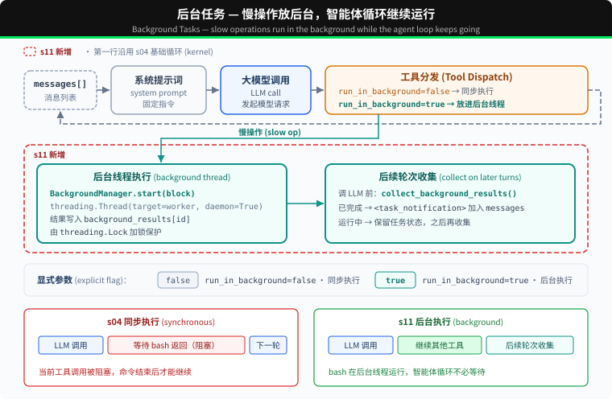

# s11: Background Tasks — 慢操作放后台

s01 → ... → s09 → s10 → `s11` → [s12](../s12_cron_scheduler/) → s13 → ... → s16 → s17

> *"慢操作放后台，Agent Loop 继续运行"* — 后台线程执行命令，后续轮次收集完成结果。
>
> **Harness 层**: 后台 — 异步执行, 不阻塞主循环。

---

## 问题

读取文件或运行 `git status` 通常很快，同步执行时等待并不明显。但安装依赖、执行完整测试或构建项目可能持续几分钟。在命令返回前，Harness 无法处理当前响应中的下一个工具调用，也不能进入下一轮。

如果后续工作并不依赖这个命令，继续等待就没有必要。例如，Agent 启动完整测试后，本来还可以检查文档或整理其他文件，但同步执行会让整个 Agent Loop 停在这次 Bash 调用上。

S11 要解决的问题是：让耗时的 Bash 命令在后台执行，使 Agent Loop 可以继续处理其他工作，并在后续轮次收集完成结果。

---

## 解决方案



本章把慢操作放入后台线程。当前工具调用先返回一个占位 `tool_result`，Agent Loop 可以继续运行；后续轮次开始时再收集已经完成的结果，以通知形式加入对话。

同步 vs 后台：

| | 同步 (s04) | 后台 (s11) |
|---|---|---|
| 慢操作 | 当前工具调用被阻塞 | 后台线程执行 |
| Agent Loop | 等待命令返回 | 收到占位结果后继续运行 |
| 结果 | 命令结束后返回 | 先返回 `bg_id`，后续轮次收集结果 |
| 判断标准 | — | bash 的 `run_in_background` 参数 |

---

## 工作原理

### should_run_background: 显式请求

模型通过 bash 工具的 `run_in_background` 参数请求后台执行。只有参数明确为 `true`，并且工具是 bash 时，才会进入后台执行路径。其他调用仍然同步执行。

```python
def should_run_background(tool_name: str, tool_input: dict) -> bool:
    return (
        tool_name == "bash"
        and tool_input.get("run_in_background") is True
    )
```

不再根据 `install`、`build` 或 `test` 等关键词猜测。是否进入后台由工具调用明确决定。

### BackgroundManager: 后台执行与生命周期

`BackgroundManager` 保存任务状态和完成队列。`start()` 先登记任务，再启动 daemon 线程，并立即返回 `bg_id`：

```python
class BackgroundManager:
    def __init__(self):
        self.tasks = {}
        self.results = {}
        self._ready = []
        self._lock = threading.Lock()

    def start(self, block) -> str:
        # Register task, then run _run() in a daemon thread.
        ...

    def _run(self, task_id: str, command: str):
        output, exit_code = _run_bash_process(command)
        status = "completed" if exit_code == 0 else "failed"
        with self._lock:
            self.tasks[task_id]["status"] = status
            self.results[task_id] = _format_bash_result(output, exit_code)
            self._ready.append(task_id)
```

命令以非零状态退出或 worker 抛出异常时，任务会进入 `failed`。Shell 会在独立的进程组中启动；命令完成、超时，或 Agent 经正常路径、`SIGTERM` 退出时，运行时会停止原进程组。这只是生命周期清理，并不是沙箱；另建 session 的进程仍可能离开该进程组。

### collect_background_results: 通知收集

后续轮次开始时，`collect()` 从完成队列中取出结果，并格式化为 `<task_notification>` 通知：

```python
def collect_background_results() -> list[str]:
    return BACKGROUND.collect()
```

通知不复用原始 `tool_use_id`。原始 tool call 已经用占位 `tool_result` 回复了；后续收集完成结果时，会用 `task_notification` 格式把它作为独立事件加入对话。一个 `tool_use` 仍然只对应一个 `tool_result`。

### 循环中的集成

每次调用 LLM 前，Agent Loop 先收集已经完成的后台结果。`execute_tool()` 仍然在主线程执行 `PreToolUse`，然后再选择同步或后台执行：

```python
while True:
    inject_background_results(messages)
    response = client.messages.create(...)

def execute_tool(block) -> str:
    blocked = trigger_hooks("PreToolUse", block)
    if blocked is not None:
        return str(blocked)
    if should_run_background(block.name, block.input):
        task_id = start_background_task(block)
        output = f"[Background task {task_id} started]"
    else:
        output = call_tool(block)
    trigger_hooks("PostToolUse", block, output)
    return output
```

慢操作先返回一个带 `bg_id` 的占位 tool_result。后台结果不会主动唤醒 Agent；下一次进入 Agent Loop 时，`inject_background_results()` 才会收集已经完成的结果。

### 合起来跑

```
Turn 1:
  LLM → bash "npm install" (run_in_background=true)
  → start_background_task → bg_0001
  → tool_result: "[Background task bg_0001 started]..."
  → LLM: "OK, I'll check later. Let me also read the config."

Turn 2:
  LLM → read_file "package.json" (fast, sync)
  → tool_result: file content

Turn 3:
  → collect bg_0001 as <task_notification>
  → LLM sees: config file + install notification in one message
```

npm install 在后台运行时，Agent Loop 继续执行了 read_file。

---

## 本章新增了什么

| 组件 | S04 Kernel | S11 |
|------|-----------|-----------|
| 执行模型 | 全部同步 | 慢操作后台线程 + 通知注入 |
| bash schema | `command` | `command` + `run_in_background` |
| 新函数 | — | `should_run_background`, `start_background_task`, `collect_background_results`, `inject_background_results` |
| 新类型 | — | `BackgroundManager` |
| 通知格式 | — | `<task_notification>`（不复用 tool_use_id） |
| 循环行为 | 工具同步执行 | 显式后台执行，后续轮次收集完成结果 |
| 工具 | 5 | 5（bash schema 增加一个参数） |

---

## 试一下

```sh
cd learn-claude-code
python s11_background_tasks/code.py
```

试试这些 prompt：

1. `Run pip list in the background and find all Python files in this directory`
2. `Run npm install (use run_in_background) and while waiting, read package.json`
3. `Run a short sleep in the background, then list all Markdown files`

观察重点：显式设置 `run_in_background` 后，命令有没有被送到后台？`bg_id` 是否返回？后续轮次有没有以 `<task_notification>` 格式收集完成结果？

---

## 产品经理视角

> 慢活放到后台，Agent 和用户都不用干等。产品经理要定的是「多慢算慢」和「做完了怎么通知」。

### 什么信号说明需要它

- 有耗时几分钟以上的操作：跑报表、批量处理、长时间的测试、深度调研。
- 等待期间用户什么都做不了，或者干脆关掉页面走了。
- 慢操作进行的同时，其实还有别的事可以做。

### 代价

- **结果回来的时机不好控制**：Agent 可能正在做别的事，要处理「中途插进来的结果」。
- **失败了容易没人知道**：需要通知和兜底。
- **要控制总量**：同时跑的后台任务多了，资源和费用都要管。

### 先试试更便宜的办法

- 让用户等，但显示进度和预计时间。
- 把大任务拆小，让每一块都很快。

### 你要拍板的规则

| 规则 | 示例 |
|---|---|
| 多慢算慢 | 预计超过 30 秒的操作转到后台 |
| 做完怎么通知 | 界面提示加消息推送；用户已经离开的，发站内信或邮件 |
| 失败谁兜底 | 自动重试一次，还失败就通知用户，并说明原因 |
| 同时最多跑几个 | 每个用户最多 3 个后台任务 |

### 怎么衡量

- 用户的等待时长。
- 后台任务的失败率；失败以后，用户知道的比例。
- 等待期间的用户流失率。

### 真实产品里的样子

- ChatGPT 的深度研究一次要跑好几分钟，用户可以先离开，做完再回来看。
- OpenAI Codex 的云端任务、Cursor 的云端 Agent，把整个编程任务放到云端去跑，做完交给用户一份结果。
- Claude Code 可以把耗时的命令放到后台运行，自己接着处理别的事。

### 面试题

**「生成一份报告要 5 分钟，用户体验很差，怎么办？」**

答题要点：

- 先看能不能变快：拆小、并行。
- 实在快不了就转后台：立刻告诉用户「已经开始，预计 5 分钟」。
- 做完主动通知；失败要有兜底和说明。
- 用等待期间的流失率来衡量。

> 17 个部件的判断卡放在一起比较，见 [选型篇](../guide/README.md)。

---

## 接下来

后台任务解决了"慢操作不阻塞"。但如果想定时做某件事呢？比如"每天早上 9 点跑测试"、"每 5 分钟检查一次服务器状态"。

s12 Cron Scheduler → 给 Agent 装一个闹钟。


<!-- translation-sync: zh@v7, en@v7, ja@v7 -->
