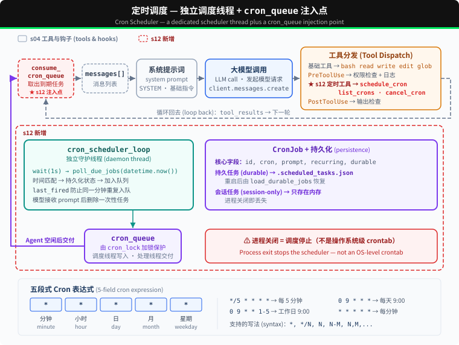

# s12: Cron Scheduler — 按时间启动任务

s01 → ... → s10 → s11 → `s12` → [s13](../s13_agent_teams/) → ... → s17

---

## 本章要学会的判断

- **它解决什么**：到点自动做事：日报、巡检、提醒，不用等人来问。
- **什么时候需要它**：要按时间主动做事，而不是等用户发起。
- **你要拍板的规则**：谁能设定时任务；频率上限；到期是否自动停止；没人盯着时允许做哪些事（通常要更严）。

> 代码看不懂可以先跳过，到网页上看「回放」动画。详细的判断方法在本章末尾的「产品经理视角」。

---

## 问题

S11 解决的是命令开始后的执行方式：耗时的 Bash 命令可以在后台运行。但它不会记录某项工作应该在什么时间开始，也没有组件持续检查当前时间。

对于“每天早上 9 点跑测试”或“每 30 分钟检查 CI 状态”这样的请求，如果只依靠当前的 Agent Loop，用户仍要在每次到点后重新发送 prompt。Harness 需要保存执行时间，到点后把对应的 prompt 加入待执行队列，再在 Agent 空闲时交给 Agent Loop。

---

## 解决方案



假设 Agent 注册了下面这项任务：

```text
cron:   0 9 * * *
prompt: run tests
```

调度线程在本地时间 09:00 匹配到这项任务，把 `[Scheduled] run tests` 放进 `cron_queue`。队列处理线程等到 Agent 空闲后启动一轮 Agent Loop，模型随后可以调用 Bash 执行测试。

S12 的代码保留 S04 的五个基础工具和 Hooks，再增加 `schedule_cron`、`list_crons`、`cancel_cron`。它不包含 S11 的后台命令，因为这里传递的是一条待执行的 prompt，而不是某个后台命令的执行结果。

---

## 工作原理

### CronJob 保存什么

```python
@dataclass
class CronJob:
    id: str
    cron: str
    prompt: str
    recurring: bool
    durable: bool
    pending_delivery: bool = False
    last_fired: str | None = None
```

`cron` 决定何时触发，`prompt` 是触发后交给 Agent 的任务。`pending_delivery` 表示任务已经到期但尚未被模型接收，`last_fired` 防止同一分钟重复入队。

### 五段式 Cron 表达式

```text
分钟  小时  日  月  星期
  *    *   *   *   *      每分钟
  0    9   *   *   *      每天 09:00
 */5   *   *   *   *      每 5 分钟
  0    9   *   *  1-5     工作日 09:00
```

本章支持 `*`、`*/N`、`N`、`N-M` 和 `N,M,...`。`schedule_job()` 会在保存任务前调用 `validate_cron()`，拒绝字段数量或取值范围不正确的表达式。

### 到期后先入队

调度线程每秒读取一次本地时间。表达式匹配且任务在当前分钟尚未触发时，`_enqueue_due_job()` 先保存 `pending_delivery` 和 `last_fired`，再把任务放进内存队列：

```python
def poll_due_jobs(moment: datetime):
    minute_marker = moment.strftime("%Y-%m-%d %H:%M")
    with cron_lock:
        for job in list(scheduled_jobs.values()):
            if job.pending_delivery or job.last_fired == minute_marker:
                continue
            if cron_matches(job.cron, moment):
                _enqueue_due_job(job, minute_marker)
```

持久化失败时，`_enqueue_due_job()` 会恢复原来的状态，不会把只存在于内存中的任务暴露给队列处理线程。

### Agent 空闲后再交付

`queue_processor_loop()` 不负责判断时间。它只检查队列，并用 `agent_lock` 避免定时任务与用户正在进行的回合同时修改会话：

```python
def queue_processor_loop(stop_event=RUNTIME_STOP):
    while not stop_event.wait(0.2):
        if not has_cron_queue() or not agent_lock.acquire(blocking=False):
            continue
        try:
            if has_cron_queue():
                run_agent_turn_locked()
        finally:
            agent_lock.release()
```

Agent Loop 从队列取出到期任务，并把它们作为新的用户消息追加：

```python
fired = consume_cron_queue()
for job in fired:
    messages.append({"role": "user", "content": f"[Scheduled] {job.prompt}"})
```

模型调用失败时，这些消息会从当前会话中移除，任务重新放回队列。模型成功接收后，一次性任务会被删除，周期任务则清除 `pending_delivery`，等待下一次匹配。

### 持久化边界

| 模式 | 保存位置 | 进程重启后 |
|---|---|---|
| `durable=True` | `.scheduled_tasks.json` | 重新加载 |
| `durable=False` | 内存 | 消失 |

`.scheduled_tasks.json` 使用临时文件和 `os.replace()` 更新。文件损坏时，启动日志会报告错误，不会静默忽略。

这里采用至少一次交付：进程若在模型接收 prompt 后、确认状态写回前退出，同一任务可能在重启后再次交付。

### 运行边界

- 调度器使用 Agent 进程的本地时间。
- Agent 进程关闭后，调度线程也会停止；`durable` 只保留任务定义。
- 重启时只恢复任务，不补跑停机期间错过的时间点。
- 定时回合运行在队列处理线程中。需要交互确认的工具调用会被拒绝，不会与主终端同时读取输入。
- 调度线程和队列处理线程只在运行 CLI 时启动，导入 `code.py` 不会启动后台线程。

需要在 Agent 关闭时仍按时执行任务，应使用系统的 crontab、systemd timer 或其他外部调度服务。

---

## 试一下

```sh
cd learn-claude-code
python s12_cron_scheduler/code.py
```

可以依次输入：

1. `Schedule "run date" every 2 minutes and keep it after restart.`
2. `List all cron jobs.`
3. `Cancel the cron job you just created.`

运行时可以查看 `.scheduled_tasks.json`，并观察到期后出现的 `[Scheduled] run date` 消息。测试一分钟级任务时，Agent 进程需要保持运行。

---

## 产品经理视角

> 定时让 Agent 从「你问它答」变成「到点主动做」，也意味着它会在没人盯着的时候干活。所以无人值守时的规则，要比平时更严。

### 什么信号说明需要它

- 用户需要周期性的事：每天早上的日报、每周巡检、到期提醒。
- 用户反复在固定的时间发同样的请求。

### 代价

- **出错没人发现**：无人值守，出了错可能很久才被发现。
- **越积越多**：定时任务越来越多，费用悄悄上涨，推送太多也会打扰用户。
- **细节很多**：时区、节假日、什么时候停止，都要处理。
- **要一直开着**：本章的实现要求程序一直运行；真实产品需要稳定运行的后台服务。

### 先试试更便宜的办法

- 很多「定时」需求其实不需要 Agent 循环：用普通的定时器，每天调用一次模型生成摘要就够了。
- 让用户手动触发，提供「一键重复上次请求」。

### 你要拍板的规则

| 规则 | 示例 |
|---|---|
| 谁能设定时任务 | 用户自己设；管理员可以统一设 |
| 频率和数量上限 | 最短每小时一次；每个用户最多 10 个 |
| 自动停止 | 默认 30 天后停止，到期前提醒用户续期 |
| 无人值守时能做什么 | 只能读数据、生成报告；不允许付款、对外发消息、删除 |
| 结果发到哪 | 推送到指定渠道；长期没人看的，提醒用户关掉 |

### 怎么衡量

- 定时任务的执行成功率。
- 结果的打开率：长期没人看，说明可以停掉了。
- 定时任务的费用占总费用的比例。

### 真实产品里的样子

- ChatGPT 的「定时任务」功能让用户设置提醒和周期性任务，到点自动运行，并限制了同时存在的任务数量。
- Dify 可以按时间触发工作流（见选型篇的对照表）。

### 面试题

**「设计一个每天早上给销售推送客户动态的 Agent，要注意什么？」**

答题要点：

- 先问需不需要 Agent：格式固定的摘要，可能调用一次模型就够了。
- 无人值守时只给只读权限。
- 控制推送频率，避免打扰。
- 失败要有通知；任务要有到期机制。
- 用打开率衡量值不值得继续推。

> 16 个部件的判断卡放在一起比较，见 [选型篇](../guide/README.md)。

---

## 接下来

调度器可以在指定时间启动一轮 Agent Loop，但这一轮仍由一个 Agent 处理。面对需要同时调查多个模块、并行修改并汇总结果的任务，Harness 还需要把工作分给多个 Agent，并收集各自的执行结果。

s13 Agent Teams → Lead 分配任务，队友独立执行，再通过收件箱返回结果。

<!-- translation-sync: zh@v9, en@v9, ja@v9 -->
