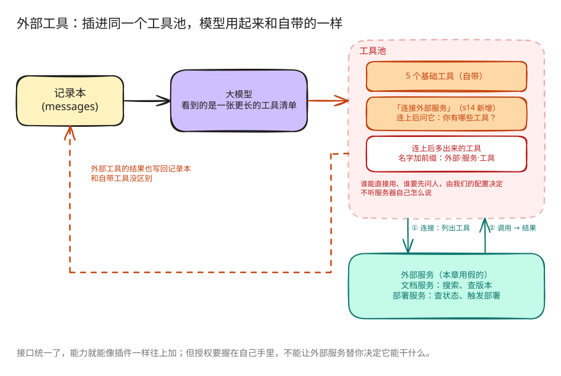

# s14: MCP Tools — 发现并调用外部工具

[s04](../s04_hooks/) → `s14` → [s15](../s15_integrated_harness/) → s16 → s17

> **Harness 层**：MCP Tools — 连接服务、发现工具，并把它们加入 Agent 的工具循环。

---

## 本章要学会的判断

- **它解决什么**：用一套通用接口，把已有系统（CRM、工单、知识库）和第三方工具接进来。
- **什么时候需要它**：要接好几个外部系统，希望接法统一。
- **你要拍板的规则**：允许接哪些服务（白名单）；外部工具默认按什么权限处理；数据能不能流出公司。

> 代码看不懂可以先跳过，到网页上看「回放」动画。详细的判断方法在本章末尾的「产品经理视角」。

### 本章新词

每章最多三个新词。看不懂的其他词，去[名词表](../guide/glossary.md)查。

| 词 | 意思 | 比喻 |
|---|---|---|
| 外部服务 | 公司里已有的系统，或第三方的工具 | 隔壁部门 |
| 统一插头（MCP） | 让任何外部服务都用同一种方式报出自己有哪些工具、怎么调用 | 通用充电口 |
| 工具池 | 自带工具和外部工具放在一起的那张清单 | 一个工具箱 |

---

## 问题

前面的工具都是直接写在课程代码里的。要接文档系统和部署平台，我们当然可以继续手写「搜文档」「查部署状态」「触发部署」，但每多接一个服务，就要多维护一套工具说明、参数格式和调用代码。

统一插头把这件事拆成两个角色：外部服务负责报出自己有哪些工具、怎么调用；程序负责连接、起名、权限检查，再把发现的工具交给模型。

---

## 解决方案



本章从 s04 的五个基础工具和钩子出发，加三样东西：

- 一个「连接外部服务」工具：连上后问它「你有哪些工具」。
- 一张会变长的工具清单：连上的外部工具都加进来，名字前面加上服务名，避免重名。
- 一份授权表：哪些外部工具可以直接用、哪些要先问人，由我们的配置决定，不听服务器自己说。

课程里的「文档服务」和「部署服务」是程序里假扮的，用来演示「列出工具」和「调用工具」这两步。真正的网络连接不在本章实现。

---

## 工作原理

### 1. 基础 Agent Loop 不需要改变

每轮调用模型前，Harness 组装当前工具池：

```python
def agent_loop(messages: list):
    while True:
        tools, handlers = assemble_tool_pool()
        response = client.messages.create(
            model=MODEL,
            system=assemble_system_prompt(),
            messages=messages,
            tools=tools,
            max_tokens=8000,
        )
        ...
```

连接新 server 后，下一轮 `assemble_tool_pool()` 会把新工具加入模型输入。工具执行后，结果仍作为 `tool_result` 追加到 messages。

### 2. MCPClient 保存发现结果和调用入口

```python
class MCPClient:
    def register(self, tool_defs, handlers):
        self.tools = list(tool_defs)
        self._handlers = dict(handlers)

    def call_tool(self, tool_name, args):
        handler = self._handlers.get(tool_name)
        if not handler:
            return f"MCP error: unknown tool '{tool_name}'"
        try:
            return str(handler(**args))
        except Exception as error:
            return f"MCP error: {type(error).__name__}: {error}"
```

`register()` 对应课程里的工具发现结果，`call_tool()` 对应调用入口。错误会返回给模型，不会直接结束 Agent Loop。

### 3. connect_mcp 只负责连接和发现

```python
def connect_mcp(name: str) -> str:
    if name in mcp_clients:
        return f"MCP server '{name}' already connected"
    factory = MOCK_SERVERS.get(name)
    if not factory:
        return f"Unknown server '{name}'"
    server = factory()
    mcp_clients[name] = server
    ...
```

开始时，模型只看到五个基础工具和 `connect_mcp`。调用 `connect_mcp(name="docs")` 后，Harness 保存 docs client。下一轮模型调用会看到：

```text
mcp__docs__search
mcp__docs__get_version
```

### 4. 前缀区分不同 server 的同名工具

多个 server 都可能提供 `search` 或 `status`。Harness 使用：

```text
mcp__{server}__{tool}
```

`normalize_mcp_name()` 把不适合模型工具名的字符替换为下划线。组装工具池时还会检查规范化后的名称冲突和 64 字符长度限制：

```python
prefixed = f"mcp__{safe_server}__{safe_tool}"
if prefixed in origins:
    raise ValueError("MCP tool name collision after normalization")
```

因此 `docs.one/get.version` 和 `docs_one/get_version` 不会悄悄映射到同一个名字。

### 5. 工具定义和 handler 一起加入工具池

```python
tools.append({
    "name": prefixed,
    "description": tool_def.get("description", ""),
    "input_schema": schema,
})
handlers[prefixed] = (
    lambda *, client=server, tool=raw_name, **kwargs:
    client.call_tool(tool, kwargs)
)
```

模型看到带前缀的名字；handler 仍使用 server 原始工具名调用 `MCPClient`。默认参数保存当前 client 和 tool，避免循环里的 lambda 全部指向最后一个工具。

### 6. 权限由宿主配置决定

MCP server 可以提供 `readOnlyHint` 或 `destructiveHint`，但这些信息来自 server，不能直接作为授权依据。本章使用宿主侧策略：

```python
MCP_HOST_POLICY = {
    ("docs", "search"): "allow",
    ("docs", "get_version"): "allow",
    ("deploy", "status"): "allow",
    ("deploy", "trigger"): "confirm",
}
```

`permission_hook()` 根据规范化后的工具名查询这份策略。未配置的外部工具默认需要用户确认；即使 description 写着 `readOnly`，也不会自动放行。

### 7. 工具输入错误留在工具边界内

模型可能漏传参数，也可能传入 server 不接受的字段。`execute_tool()` 和 `MCPClient.call_tool()` 都会捕获异常，并返回错误 `tool_result`：

```text
MCP error: TypeError: <lambda>() missing 1 required argument: 'query'
```

模型可以在下一轮修正参数，而不是让课程脚本直接退出。

---

## 相对 s04 的变化

| 组件 | s04 | s14 |
|---|---|---|
| 基础工具 | 五个固定工具 | 保持不变 |
| 工具来源 | `code.py` 中的定义 | 基础工具加动态发现的 MCP 工具 |
| 工具池 | 固定 `TOOLS` | 每轮由 `assemble_tool_pool()` 组装 |
| 外部工具名 | 无 | `mcp__{server}__{tool}` |
| 权限 | Shell 和路径检查 | 增加宿主侧 MCP 策略 |
| MCP transport | 无 | 使用进程内模拟 server 展示协议边界 |

本章不带入 Task、Background、Cron、Team 或 Worktree。它们会在 s15 的 Integrated Harness 中与 MCP 合并。

---

## 试一下

```sh
cd claude-code-harness-study
python s14_mcp_plugin/code.py
```

试试这些话：

1. `连接文档服务，搜索「agent hooks」，再告诉我文档的当前版本`
2. `连接部署服务，查看 web 服务的状态，不要触发部署`

观察重点：连接之后，下一圈模型看到的工具清单变长了；查状态按授权表直接做，触发部署会停下来问你。

---

## 产品经理视角

> MCP 是 Agent 接外部系统的「通用插头」。接得越多，Agent 能做的越多；但每接一个，就是把一部分安全交到了别人手里。

### 什么信号说明需要它

- 要接公司已有的系统：客户管理系统、工单、知识库、日历。
- 想用第三方现成的能力，不想每一个都自己做。
- 希望以后换 Agent 方案时，已经接好的系统不用重做。

### 代价

- **第三方的安全风险**：服务可能被篡改，或者返回的内容里藏着诱导 Agent 的指令。
- **数据会流出去**：数据会发到外部服务。
- **工具变多，模型更难选对**：s02 的问题会被放大。
- **跟着不稳定**：外部服务不稳定，Agent 也跟着不稳定。

### 先试试更便宜的办法

- 只接一两个系统：直接做成内置工具。

### 你要拍板的规则

| 规则 | 示例 |
|---|---|
| 允许接哪些服务 | 白名单，由安全团队审核；不允许用户随意添加 |
| 默认按什么权限处理 | 外部工具一律先归入「先问人」；审核过的只读工具再放行 |
| 数据能不能流出 | 客户数据不能发给公司以外的服务 |
| 接多少 | 一个场景只接必需的，用不到的就断开 |

### 怎么衡量

- 外部工具的调用成功率和响应时间。
- 接入变多以后，工具选错率有没有上升。
- 安全事件的数量。

### 真实产品里的样子

- MCP 由 Anthropic 在 2024 年底提出，之后 OpenAI、Google、微软等相继宣布支持，已经成为行业通用标准。2025 年底，它被捐给了 Linux 基金会旗下新成立的基金会来管理。
- Claude、ChatGPT、Cursor 都能接 MCP 服务；GitHub、Notion、飞书等也提供了官方的 MCP 服务。
- 选型篇的对照表里，Coze 开源版还没有实现 MCP 调用。

### 面试题

**「Agent 要接公司的客户管理系统和工单系统，你关注什么？」**

答题要点：

- 方式：用 MCP，还是直接做成内置工具。
- 权限：只读还是能写；写入操作要走 s03 的「先问人」。
- 数据：哪些字段可以给模型看，要不要脱敏。
- 管理：白名单和接入审核。
- 稳定性：外部系统挂了，Agent 怎么回应用户。
- 用调用成功率和安全事件数来衡量。

> 16 个组件的判断卡放在一起比较，见 [选型篇](../guide/README.md)。

---

## 接下来

到这里，外部工具还是一条单独的分支。s15 总装 → 把基础工具、钩子、技能、压缩、记忆、任务板、后台、定时、团队和外部工具放进同一个循环。
