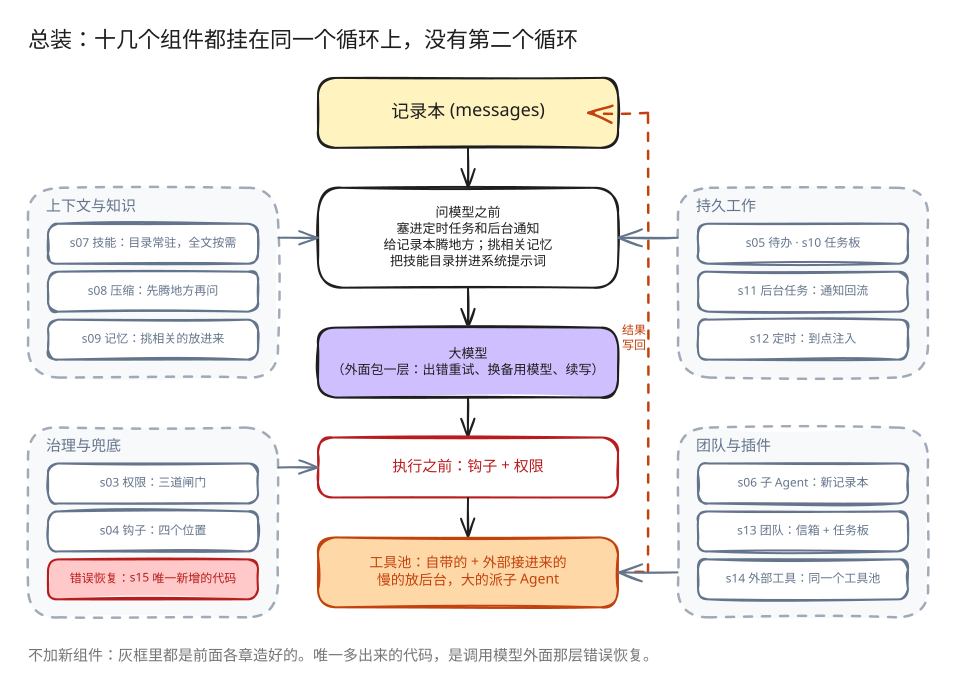

# s15: Agent Harness 集成 — 多种机制，一个循环

s01 → ... → s13 → [s14](../s14_mcp_plugin/) → `s15` → [s16](../s16_workflow_runtime/) → s17

> *"多种机制，一个循环"* — 工具、权限、记忆、任务、团队、插件都挂在同一个 while True 上。
>
> **Harness 层**: 集成 — 把本章示例实际使用的机制放进同一个可运行系统。

---

## 本章要学会的判断

- **这一章不是组件**：它不加新组件，而是把 s01～s14 的组件装进同一个循环，变成一个完整的系统。唯一新增的代码是调用模型时的错误恢复（出错了重试、换备用模型、回答被截断就接着写），那是让总装后的系统跑得稳的包装，不是一个组件。
- **要学会什么**：拿 16 个组件当清单，拆解任何一个 Agent 产品，几分钟内看出它有什么、缺什么。
- **要注意什么**：组件放到一起会互相影响。比如压缩可能把计划清单压掉，子 Agent 也必须受权限约束。

> 代码看不懂可以先跳过，到网页上看「回放」动画。详细的判断方法在本章末尾的「产品经理视角」。

### 本章新词

每章最多三个新词。看不懂的其他词，去[名词表](../guide/glossary.md)查。

| 词 | 意思 | 比喻 |
|---|---|---|
| 总装 | 把前面造好的组件装进同一个循环 | 零件装成整车 |
| 错误恢复 | 模型调用出错时重试、换备用模型、接着写 | 备胎和应急箱 |
| 拆解 | 拿 16 个组件当清单，看一个产品有什么、缺什么 | 验车单 |

---

## 问题

前面每一章都是把一个组件单独放在自己的示例里。本章把它们接到一起。

一个能长期干活的 Agent 要同时有：

- 工具分发和权限边界
- 四个位置的钩子
- 待办清单和任务板
- 技能、记忆、系统提示词的拼装
- 压缩和错误恢复
- 后台任务和定时
- 团队、协议和空闲认领
- 任务绑定的独立工作目录
- 外部工具接入

本章不再引入新组件，而是展示这些机制各自从哪里进入循环，它们产生的事件又怎么回到同一本记录本。为了让这个系统在真实网络下跑得稳，调用模型的地方包了一层错误恢复，这是本章唯一新增的代码。

---

## 解决方案



一圈循环现在长这样：

1. 你输入一句话，「用户输入之后」的钩子先响。
2. 问模型之前：把到点的定时任务和后台完成通知塞进记录本；给记录本腾地方；挑出相关记忆；把技能目录和外部服务状态拼进系统提示词。
3. 问模型。出错就重试，连续出错换备用模型，回答被截断就接着写。
4. 模型不要工具：「结束前」的钩子响，回答你。
5. 模型要工具：「执行之前」的钩子和权限先过一遍；再分发给自带工具、外部工具，或者丢到后台；「执行之后」的钩子再响。
6. 工具结果和各种通知写回记录本，下一圈。

循环还是那个循环：问模型，看它要不要工具，执行，结果写回去。

---

## 组件在循环中的位置

| 位置 | 组件 | 作用 |
|------|------|------|
| 用户输入前后 | `UserPromptSubmit` hooks | 记录、注入、审计用户输入 |
| LLM 前 | cron queue | 把定时触发的 prompt 注入 `messages` |
| LLM 前 | background notifications | 后台任务完成后以 `<task_notification>` 注入 |
| LLM 前 | compaction pipeline | 先压大输出，再裁历史，再压旧 tool_result，必要时摘要 |
| LLM 前 | memory / skills / MCP state | 组装 system prompt，让模型看到当前能力和长期上下文 |
| LLM 调用 | error recovery | 429/529 重试，`max_tokens` 升级，prompt too long 触发 reactive compact |
| 工具执行前 | `PreToolUse` hooks + permission | 拦截危险命令、写越界、破坏性 MCP 工具 |
| 工具分发 | `assemble_tool_pool` | 组装内置工具和 MCP 动态工具 |
| 工具执行时 | background dispatch | 显式标记的 bash 操作放入 daemon thread，主循环先返回占位结果 |
| 工具执行后 | `PostToolUse` hooks | 大输出告警、日志等后处理 |
| 返回循环 | tool_result | 每个 `tool_use` 对应一个 `tool_result`，再回到下一轮 |
| 本轮没有 tool_use / 停止时 | `Stop` hooks | 统计、清理、审计 |

---

## code.py 包含什么

### 工具与分发

内置工具池包含 26 个工具：

```text
bash, read_file, write_file, edit_file, glob
todo_write, task, load_skill, compact
create_task, update_task, list_tasks, get_task, claim_task, complete_task
schedule_cron, list_crons, cancel_cron
spawn_teammate, list_teammates, send_message
request_shutdown, request_plan, review_plan
create_worktree
connect_mcp
```

`assemble_tool_pool()` 每轮组装：

```text
BUILTIN_TOOLS + connected MCP tools
BUILTIN_HANDLERS + mcp__server__tool handlers
```

所以 `connect_mcp("docs")` 后，下一轮工具池里会出现 `mcp__docs__search`。

### 权限和 hooks

权限不写死在工具执行行里，而是作为 `PreToolUse` hook：

```python
blocked = trigger_hooks("PreToolUse", block)
if blocked:
    results.append(tool_result(block.id, blocked))
    continue
```

这样 permission、log、审计都可以挂在同一个 hook 点上。Lead、一次性 subagent 和队友的工具都会先经过 `PreToolUse`；允许执行的调用会在 handler 返回后触发 `PostToolUse`。

权限判断不会把 MCP server 自己写的 description 当成授权依据。宿主维护一组精确的已知只读工具名单，其他 MCP 工具都要询问用户。文件工具越过 `WORKDIR` 会直接拒绝，每条 bash 命令执行前都会询问。只有前台用户轮次可以弹出交互确认；异步轮次直接拒绝需要确认的操作，不和主 CLI 争抢输入。

### 计划与任务

S15 同时保留两层计划：

- `todo_write`：当前会话内的轻量计划，保存在内存中
- task graph：跨会话、可依赖、可认领的任务文件，写入 `.tasks/task_*.json`

前者帮助单个 Agent 不漂移；后者支撑团队协作。

两者目标相近，但实现不同：`todo_write` 整表替换当前会话清单，task record 则有稳定 ID 和单条生命周期更新。下面单独出现的 `task` 工具表示“一次性派发隔离 subagent”，不是 Task System。

集成宿主中的任务图仍采用两阶段构建：Lead 先创建所有任务节点，再使用 `create_task` 返回的运行时 ID 调用 `update_task`。队友只能列举、认领和完成任务，因此依赖结构由 Lead 在分发工作前确定。

### 子 agent 与团队

S15 有两种 delegation：

- `task`：一次性 subagent。独立 `messages[]`，中间过程丢弃，只返回最终摘要。
- `spawn_teammate`：持久队友线程。传入 ready `task_id` 时，运行时会在线程启动前完成认领；不传时，队友可以在 IDLE 中等待后续任务。没有 assignment 的队友不能使用文件或 Shell 工具。它按 `WORK → result → IDLE` 运行，不设固定的工具轮数上限；模型或分发失败会发出 `error`，线程清理会把未完成 assignment 释放回任务板。每次调用模型前都会先读取收件箱，因此直接消息和关机请求不会被连续的 tool-use 轮次饿死。idle 时先等待 `MessageBus` 消息，只在超时后扫描就绪 task，并以原子操作最多认领一个。

Lead 启动队友后结束当前轮次，不在模型循环里反复查询状态。队友事件进入 Lead 收件箱后，运行时会自动唤醒下一轮。

一次性 subagent 解决“上下文隔离”；持久队友解决“长期并行协作”。

### 记忆、技能和 prompt

S15 直接复用 s09 的 Memory runtime。每轮调用模型前，它读取 `.memory/MEMORY.md` 目录，根据当前请求选择相关记录，再把选中的正文交给 `assemble_system_prompt(context)`。本轮结束后，`extract_memories()` 提取可跨会话使用的信息；有新增记录时再运行 `consolidate_memories()`。

同一份 system prompt 还会加入身份、工具说明、workspace、skills catalog 和已连接的 MCP server。技能只放目录，完整内容通过 `load_skill(name)` 按需加载。

### 压缩和恢复

LLM 前先跑压缩管线：

```text
tool_result_budget → snip_compact → micro_compact → compact_history
```

调用模型时再包一层恢复：

- 429：指数退避重试
- 529：指数退避，连续失败可切 fallback model
- `max_tokens`：先提高 max_tokens，再要求 continuation
- prompt too long：reactive compact 后重试

### 后台和 cron

bash 调用设置 `run_in_background=true` 后，主循环不再等待命令结束，而是先返回占位结果：

```text
should_run_background → start_background_task → placeholder tool_result
后台完成 → task_notification → 下一轮注入 messages
```

只有显式标记的 bash 调用会进入后台路径。命令非零退出或 worker 抛出异常时会发出 `failed` 通知。每条 Shell 命令都在独立进程组中运行；命令结束，或 Agent 经正常路径、`SIGTERM` 退出时，运行时会停止原进程组。另建 session 的进程可以离开这个进程组。

cron 调度器独立 daemon thread 每秒检查一次。durable 的一次性任务会先持久化为 `pending_delivery`，再进入队列，并保留到包含该 prompt 的模型调用成功；调用失败会放回队列，重启后也会再次入队，因此交付语义是至少一次。CLI 同时监听 `cron_queue`、Lead 收件箱和已经结束的后台任务，任一事件都能自动唤醒一轮 Agent。

### worktree 与 MCP

从 s13 继承的任务级 worktree 机制负责管理任务工作目录：

- pending 且未被认领的 task 可以留在主工作区，也可以通过 `create_worktree(name, task_id)` 绑定独立分支和目录
- 创建前会校验 task、名称、路径、分支和 Git registry；Git 命令失败后还会核对 registry 和分支状态，任何部分创建的 checkout 都保持未绑定并保留供人工恢复
- idle 队友以原子操作认领一个就绪 task，assignment 同时记录 `task_id` 和有效 `cwd`
- Lead 也可以把 ready `task_id` 直接传给 `spawn_teammate`，认领成功后才启动线程
- 队友所有文件工具都使用该 `cwd`；只有 task owner 能完成任务，assignment 会保留到当前模型轮次结束
- 移除保留在宿主侧的 `remove_worktree()` 函数中，模型不能调用。用户或宿主先检查任务所有权、assignment lease、后台工作和 Git 状态；破坏性移除需要另行取得用户确认

worktree 只改变工具的默认工作目录，用于分离 working copy，并不是安全沙箱。进程组清理也无法约束另建 session 的进程，因此删除保留为宿主操作。

认领或释放 task 会改变 assignment version，使旧的 plan approval 失效；普通 `send_message` 只传递消息，不会改变 task identity 或 plan 状态。

MCP 负责外部能力：

- `connect_mcp(name)` 连接 mock server
- `assemble_tool_pool()` 把 MCP 工具组装进工具池，并拒绝规范化后的名称冲突
- 工具名统一为 `mcp__server__tool`

---

## 相对 s14 的变化

| 范围 | s14 MCP | s15 Integrated Harness |
|------|---------|-------------------------|
| 内置工具 | 6 个 | 25 个 |
| 外部工具 | 已连接的 MCP 工具 | 沿用同一套动态 MCP 路径和宿主策略 |
| 本地机制 | S04 工具、hooks、权限和 MCP | todo、subagent、skills、compaction、memory、task graph、后台 bash、cron、teams 和 worktrees |
| 事件来源 | 用户输入和工具结果 | 用户输入、工具结果、cron prompt、后台通知和 team events |

---

## 试一下

```sh
cd claude-code-harness-study
python s15_integrated_harness/code.py
```

试试这些话：

1. `检查这个仓库，告诉我哪些 Python 文件最重要。`
2. `从已连接的文档中查一下 agent loop 的相关说明。`
3. `请在独立的工作目录里并行重构认证模块和登录页，改之前先把各自的计划给我看。`
4. `3 分钟后提醒我开会。`
5. `在后台安装依赖，同时继续阅读 README.md。`

观察重点：

- 每次用工具之前，是不是都先过了钩子和权限
- 连接外部服务之后，下一圈工具清单有没有变长
- 标了「放后台」的命令是不是马上回了一句「已启动」
- 到点是不是自动提醒开会
- 队友是不是先交了计划，批准之前停着不动
- 空闲的队友是不是一次只认领一个可以开始的任务
- 队友的文件工具是不是都切到了它认领的那个任务的目录

---

## 产品经理视角

> 真实的 Agent 产品，都是这些组件的组合。学会拿 16 个组件当清单去拆解产品，是这一章对产品经理最大的价值。

### 用四个问题拆解任何一个 Agent 产品

1. **它能做什么？** 看工具：自带哪些工具（s02），能接哪些外部系统（s14）。
2. **它不让做什么？** 看权限（s03）：什么时候会弹出确认，什么事它会直接拒绝。
3. **它怎么撑住长任务？** 看计划（s05）、压缩（s08）、记忆（s09）、后台任务（s11）。
4. **它怎么分工？** 看子 Agent（s06）、团队（s13）、工作流（s16）。

### 练习：拆解一个你常用的产品

找一个你用过的 Agent 产品（Claude Code、Cursor、Manus、扣子上的某个智能体都可以），一边用一边填这张表：

| 组件 | 去哪里观察 | 你看到了什么 |
|---|---|---|
| 工具 | 它调用了哪些工具，界面上有没有显示 | |
| 权限 | 什么操作前会问你，什么事它会拒绝 | |
| 计划 | 长任务开始前，有没有列清单 | |
| 压缩 | 聊得很长以后，有没有提示，会不会忘事 | |
| 记忆 | 新开一个对话，它还记不记得你 | |
| 后台 | 慢操作时，你能不能做别的事 | |
| 外接系统 | 能不能接你的文档、日历、代码仓库 | |

填完再回答两个问题：它**缺**了哪个组件？如果你是这个产品的产品经理，你会先补哪一个，为什么？

### 组合起来以后的新问题

组件单独看都好理解，放到一起会互相影响：

- **压缩和计划**：压缩时如果把计划清单也压掉了，Agent 就会忘了做到哪一步。所以要规定计划清单属于「必须保留」的内容。
- **子 Agent 和权限**：子 Agent 一样能改文件、执行命令，权限规则必须对它同样生效。
- **记忆和隐私**：对话里的敏感信息被压缩成摘要，或者被提取进记忆，就会保留得比用户预想的更久。
- **组件越多越难排查**：一个回答不对，可能是工具、压缩、记忆中任何一环出了问题。这也是选型篇反复强调「最小可行 Harness」的原因。

### 面试题

**「拆解一个你常用的 Agent 产品。」**

答题要点：

- 用 16 个组件做清单，一项项说：它有什么、缺什么。
- 推测它为什么这样取舍，比如「它不做记忆，可能是出于隐私考虑」。
- 说出你会改哪一点、为什么、用什么指标验证。
- 这道题考的不是你知道多少产品，而是你有没有一套拆解的方法。

> 16 个组件的判断卡放在一起比较，见 [选型篇](../guide/README.md)。

---

## 接下来

[s16 工作流（Workflow Runtime）](../s16_workflow_runtime/) 会往这个总装好的系统里加一个「工作流」工具：把固定的流程写在代码里，并记录进度，中断后能接着跑。
